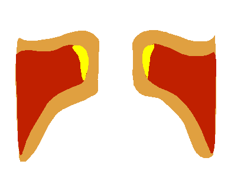
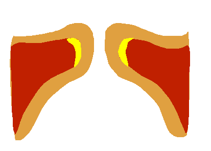

# 第三篇　声源（下）：声区

## 本篇要点

- 声区的名词之所以混乱，是因为它们来自**三套不同的命名依据**：振动感的位置、听感和音色、生理机制。
- 生理上，声带的振动方式主要有四种**喉部机制**（M0 到 M3），唱歌主要用 **M1**（真声）和 **M2**（假声、女声的头声）。
- M1 和 M2 的本质区别在于声带的"体"是否参与振动。两者之间的切换是**突然的跳跃**，这就是破音和断层的生理本质。
- M1 和 M2 的音域有**大约一个八度以上的重叠区**，同一个音高可以用两种机制唱。
- **混声**不是第三种振动方式，而是在重叠区里，"很薄的 M1"和"闭合充分的 M2"在听感上的相遇。
- "头声"在不同性别、不同流派中指不同的东西。
- 换声区的问题同时来自**声源层**和**共鸣层**。

---

## 一、什么是声区

关于声区，最经典的定义来自 19 世纪的西班牙声乐教育家 Manuel García（他也是喉镜的发明者）。大意是：

> 声区是一串从低到高连续的、音色相近的音，它们由同一种机械原理产生；这种原理与产生另一串同样音色相近的音的原理有本质区别。

这个定义有两个关键点：

1. **声区是一种"机制"，而不是一段固定的音高。**
2. 不同声区之间存在**本质区别**，所以声区之间可能出现断裂。

---

## 二、名词混乱的根源：三套命名依据

| 命名依据 | 例子 | 说明 |
|---|---|---|
| 振动感的位置 | 胸声、头声 | 描述的是唱歌时身体哪里有振动感 |
| 听感和音色 | 真声、假声、混声、强混（belt） | 描述的是声音听起来像什么 |
| 生理机制 | M0、M1、M2、M3 | 描述声带实际怎么振动 |

很多老师在同一句话里会混用不同依据的名词，比如"用胸声的感觉唱混声，再往上过渡到头声"。这句话里，"胸声"和"头声"是感觉名词，"混声"是听感名词，它们并不在同一个层面上。

### "胸腔共鸣"和"头腔共鸣"是感觉描述

"胸声"和"头声"这两个名字来自唱歌时的振动感：唱低音时胸口能感到明显的振动，唱高音时振动感集中在头部和面部。

但这只是振动沿着骨骼和组织传导时产生的**感觉**。声音真正的共鸣发生在声带**上方**的声道里（喉咽、口咽、口腔、鼻腔）。胸腔在声带**下方**，它的振动对传到听众耳朵里的声音几乎没有贡献；鼻窦等"头腔"对声音的贡献也很有限。

所以，"胸腔共鸣""头腔共鸣"严格来说是**感觉描述**，不是共鸣的实际位置（参见第一篇"感觉的位置不等于动作的位置"）。这并不是说这些说法没用：作为一种感觉提示，它们可能帮助歌手找到某种发声状态。只是不应该把它们理解成字面上的物理事实。

---

## 三、生理学的答案：喉部机制

### 1. 四种喉部机制

法国的嗓音研究者 Roubeau、Henrich 和 Castellengo 通过测量声带振动（使用一种叫电声门图的仪器），把人声的振动方式分为四种**喉部机制**（laryngeal mechanism）：

| 机制 | 常见名称 | 声带状态 |
|---|---|---|
| **M0** | 气泡音（vocal fry） | 声带短、厚、松弛，闭合时间很长，振动不规则，音高极低 |
| **M1** | 真声、胸声 | 声带较厚，"体"和"被覆"一起振动 |
| **M2** | 假声；女声的头声 | 声带被拉长拉薄，主要只有"被覆"振动 |
| **M3** | 哨音（whistle） | 极高的音区，多见于女声和儿童 |

另一套较早的生理命名来自美国学者 Hollien，他把声区分为 pulse（脉冲，对应 M0）、modal（常态，对应 M1）和 loft（高音，对应 M2 和 M3）。所以你在英文资料里看到的 **modal voice**，基本就是 M1。

流行和音乐剧演唱主要涉及 M1 和 M2，下面重点讨论这两种。

### 2. M1 和 M2 的区别

回顾第二篇的"体—被覆"结构：声带由里面的肌肉（体）和外面柔软的黏膜（被覆）组成。

**M1** 时，甲杓肌主动参与，体和被覆**一起振动**。振动的质量大，每个周期里声带闭合的时间长，声音的泛音丰富，听起来厚实、有力，接近说话的声音。

**M2** 时，环甲肌把声带拉长拉薄，甲杓肌相对放松，**主要只有被覆在振动**。振动的质量小，闭合时间通常较短，声音轻、泛音少。



*图 3-1　M1（真声）的声带振动示意。声带厚，开合幅度大，下缘和上缘有明显的先后（垂直相位差），每个周期中有一段完全闭合的时间。*



*图 3-2　M2（假声）的声带振动示意。和图 3-1 对比：内部的肌肉几乎不动，振动主要发生在外层黏膜的边缘，开合幅度小，两侧声带只在上缘短暂接触，闭合时间短。*

研究数据也反映了这种区别。Roubeau 等人（2009）测量了每个振动周期中声带**打开**的时间所占比例（开放商）：M1 中大约在 0.3 到 0.8 之间，M2 中总是大于 0.5。换句话说，**在同一个音高上，M1 的闭合时间通常比 M2 长**。这和第二篇讲的"声带越厚越容易闭合"是一致的。

### 3. 为什么会"断"

在 M1 里往上唱时，环甲肌越拉越紧，甲杓肌要一直和它"对抗"，才能维持厚的振动方式。到了某个点，甲杓肌顶不住了，声带的"体"和"被覆"突然**脱离联动**，只剩被覆在振动，声带就跳到了 M2。

这就是**破音、翻音、断层**的生理本质：它是两种振动方式之间的**突然切换**，而不是声音慢慢变弱。切换时，音高会出现一个短暂的跳动，声带振动的幅度也会突然变小。

Roubeau 等人的研究还发现：**切换时跳动的幅度和音量有关**。音量越大，切换越突兀；如果在切换前先把音量降下来，切换可以变得几乎听不出来。这从科学上印证了歌手们的经验：越是用力喊着往上冲，换声时越容易"破"得明显。

### 4. 最重要的事实：M1 和 M2 有重叠区

M1 和 M2 的音域**有很大一段重叠**。在 Roubeau 等人（2009）的测量中（受试者包括受过训练和没受过训练的男性和女性），重叠区的宽度平均超过一个八度（男声约 17 个半音，女声约 15 个半音），而且**男女的重叠区位于相近的音高范围**，大致在 F3 到 G#4 一带。

下面是一个示意图（只表示相对关系，不是精确数据）：

```text
     -------------------------------------------->  音高升高

M1   ==============================
M2               ==============================
                 ^^^^^^^^^^^^^^^^^^  重叠区：同一个音高可以用 M1 或 M2 唱
```

这个事实有两个重要的推论：

1. **"换声点"不是一个固定的音高。** 它是你在重叠区里**被迫切换**的位置。肌肉的协调越好，这个切换点就越可控，可以推迟，也可以提前，甚至可以做到听不出来。所以，同一个人上行和下行时的换声点往往不同，大声和小声时也不同。
2. **在重叠区里，同一个音高可以有两种完全不同的唱法。** 这正是"混声""头声"这些名词争议最大的地方。

---

## 四、修正"厚薄"旋钮：连续变化加一次跳跃

第二篇把"厚薄"描述成一个旋钮。有了喉部机制的概念，可以更精确地描述它：

- **在 M1 内部，厚薄是连续变化的**：从很厚（喊叫、强混）到很薄（轻柔、接近假声的音色），中间可以平滑过渡，不会断。
- **M1 和 M2 之间是一次跳跃**：声带从整体振动变成只有被覆振动。
- **在 M2 内部，闭合度也可以连续变化**：从漏气的、很弱的假声，到闭合充分、听起来很结实的 M2。

```text
   厚、实的 M1（喊叫、强混）
     |
     |  M1 内部：连续变薄，不会断
     v
>> 很薄的 M1（轻柔的真声）
     ||
     ||  M1 与 M2 之间：一次跳跃
     ||
>> 闭合充分的 M2（结实的头声）
     ^
     |  M2 内部：闭合度连续变化
     |
   漏气的 M2（弱假声）

标有 >> 的两种状态在听感上可以非常接近，它们相遇的区域就是"混声"。
```

---

## 五、混声的生理基础

有了上面的框架，混声就可以讲清楚了。

### 1. 混声是一个听感概念

混声描述的是一种**目标声音**：在高音区，听起来既有真声的力度和说话感，又不像喊叫那么重；经过换声区时，听不出明显的断裂。

### 2. "真假声混合"只是一个比喻

声带在任何一个时刻**只能处于一种振动方式**，不可能一半在 M1、一半在 M2。对法国古典声乐中"混声"（voix mixte）的研究（Castellengo 等，2004；Lamesch 等，2007）发现：混声总是**明确地**在 M1 或 M2 中产生，从来不是一种介于两者之间的"混合机制"。

### 3. 两条路通向混声

既然混声不是第三种机制，那么在重叠区里实现混声就有两条路：

- **从 M1 出发"减重"**：保持真声的振动方式，但让声带变薄（环甲肌更多参与，甲杓肌减少），同时保持足够的闭合。
- **从 M2 出发"加实"**：用假声的振动方式，但加强闭合，再配合共鸣的调整（比如咽音），让它听起来接近真声。

在第四节的示意图中，前者是从上往下走到"很薄的 M1"，后者是从下往上走到"闭合充分的 M2"，两者在中间的跳跃处附近、在听感上相遇。

这就解释了为什么不同老师教混声的方法会**正好相反**：有的老师让你从真声往上"减重"，有的让你从假声往下"加实"。两种方法都可以成立，它们只是从不同的起点出发。

对音乐剧演员的研究也支持这一点。Bourne 和 Garnier（2012）记录了三位音乐剧女演员唱 mix 的情况，发现**每个人的策略都不一样**：有人的声带振动方式接近 legit（偏美声的唱法），有人在较低的音上接近 belt（强混）、到较高的音又切换到接近 legit 的方式，而且她们的共鸣调整也各不相同。不过这项研究的样本很小，作者也强调结果只能作为参考。

### 4. 混声需要共鸣层的配合

混声虽然主要是声源层的问题，但仅靠声带是不够的。共鸣层的调整（元音、咽音、喉位）会极大地影响一个声音听起来"像真声"还是"像假声"。这部分在第四篇和第六篇讨论。

---

## 六、"头声"在不同语境里指不同的东西

| 语境 | "头声"实际指的是 |
|---|---|
| 女声（大多数流派） | M2 |
| 美声男高音 | 换声区以上、经过"关闭"（掩盖）的声音，生理上通常**仍然是 M1** |
| 流行教学中的男声 | 常指闭合充分的 M2，有时也指很薄的 M1 |

所以，一位美声老师和一位流行老师都对一个男生说"用头声唱"，可能是在要求**两种不同的振动方式**。

类似地，很多流行老师会区分"假声"和"头声"，把它们当成两个声区。从生理上看，它们通常是**同一个机制（M2）**，区别在于闭合度：漏气、轻飘的叫假声，闭合充分、结实的叫头声。

---

## 七、"几个声区"之争

不同流派会说人声有一个、两个、三个甚至更多声区。用本篇的框架就可以理解：

- **两声区说**：对应 M1 和 M2，是最贴近生理的说法。
- **三声区说**（胸声、中声、头声，美声和 SLS 常用）：多出来的"中声区"不是第三种振动方式，而是**重叠区和过渡区**。在这里，声带的厚薄和共鸣都在逐渐调整。
- **一声区说**（"声音应该只有一个声区"）：这是一个**审美目标**，意思是要让听众听不出接缝，而不是在说生理上只有一种振动方式。

这几种说法并不矛盾，它们在描述不同的东西：一个说生理，一个说过渡过程，一个说听感目标。

---

## 八、换声区：声源层和共鸣层都有份

### 1. 换声点和换声区

**换声点**指的是声音开始需要调整、或者容易发生断裂的音高；**换声区**指的是这个调整过程所覆盖的一段音域。

美国声乐教育家 Richard Miller 在美声教学中把换声区描述为由两个点界定：

- **第一换声点**（primo passaggio）：从这里开始，说话式的厚重真声开始需要调整。
- **第二换声点**（secondo passaggio）：如果不调整，到这里就会断开、翻掉，或者只能喊上去。

两点之间就是换声区（zona di passaggio）。按 Miller 的划分，抒情男高音的第一换声点约在 **D4**，第二换声点约在 **G4**；抒情男中音大约在 B3 和 E4。具体位置因人而异。

### 2. 换声区的两个成因

**声源层的原因。** 就是上面讲的：随着音高升高，甲杓肌和环甲肌之间的平衡在变化，M1 越来越难维持，声带倾向于跳到 M2。

**共鸣层的原因。** 歌声里除了你唱的那个音（基频），还有一系列整数倍频率的**泛音**。声道对某些频率有加强作用，这些频率叫做**共振峰**，其中最低的一个叫第一共振峰。对男声来说，元音"啊"的第一共振峰大约在 700 赫兹上下。当你唱到 F#4（约 370 赫兹）附近时，声音的第二个泛音（约 740 赫兹）正好经过这个共振峰。音高继续升高，这个泛音就越过了第一共振峰，原本有效的共鸣突然"失效"，声音会变得费力、发白、想喊。

美声的"关闭"（掩盖）、元音调整等技术，就是为了解决这个共鸣层的问题。这部分在第四篇详细讨论。

**两个成因在男声的第二换声点附近叠加**，所以那里才是真正的"悬崖"。

---

## 九、声区名词对照总表

| 名词 | 命名依据 | 生理上对应 |
|---|---|---|
| 气泡音 | 听感 | M0 |
| 真声、胸声 | 听感、振动感 | M1，偏厚 |
| 中声区 | 音域位置 | M1 与 M2 的重叠区和过渡区 |
| 混声 | 听感 | 很薄的 M1，或闭合充分的 M2，并配合共鸣调整 |
| 头声 | 振动感 | 女声为 M2；美声男高音多为 M1；流行男声多指闭合充分的 M2 |
| 假声 | 听感 | M2，男声中通常指闭合较弱的状态 |
| 强混（belt） | 听感 | M1，闭合度高，音色明亮，像说话或呼喊 |
| 哨音 | 听感 | M3 |

---

## 小结

1. 声区名词来自三套依据：**振动感、听感、生理机制**。先分清一个名词属于哪一套，再讨论它的含义。
2. 生理上有四种喉部机制，唱歌主要用 **M1** 和 **M2**。两者的区别在于声带的"体"是否参与振动。
3. M1 到 M2 的切换是**突然的跳跃**，跳跃的明显程度和音量有关。
4. M1 和 M2 有**一个八度以上的重叠区**，所以换声点不是固定的，同一个音高可以有两种唱法。
5. **混声**不是第三种机制，而是"很薄的 M1"和"闭合充分的 M2"在听感上的相遇，所以教法可以从两个方向出发。
6. "头声"的含义取决于性别和流派。"假声"和"头声"通常是同一个机制，区别在于闭合度。
7. 换声区同时有**声源层**和**共鸣层**的成因，两者在男声的第二换声点附近叠加。

---

## 案例分析

> 以下是对学习者本人情况的分析，和正文理论分开。

### 1. 基本情况

- 男，多位老师认为音色更接近**男高音**。
- 换声点在 **F4 到 F#4** 之间。目前稳定能唱到 F#4；G4 和 A4 可以在练声时达到；在歌曲中可以靠喊叫唱到 G4。
- 另有一位老师认为换声点在 **D4**，理由是从 D4 开始声音会出现挤卡和负担，已经和纯真声有所区别。

### 2. D4 和 F4–F#4 两种说法都对

用 Miller 的两个换声点来看，两位老师看到的是**同一个换声区的起点和终点**：

- **D4 是第一换声点**：从这里开始，厚重的 M1 需要减重。如果不调整，就会出现你感到的负担和挤卡。说换声点在 D4 的老师，看到的是这个起点。
- **F4 到 F#4 是第二换声点**：声源层和共鸣层的问题在这里叠加。如果一路不调整，到这里就会断开或者只能喊。说换声点在 F4–F#4 的老师，看到的是这个"悬崖"。

你的第二换声点和 Miller 描述的抒情男高音（约 G4）只差一个半音左右，也接近 Roubeau 等人研究中男性受试者 M1 的平均上限（约 F#4）。不过，高男中音的第二换声点（约 E4–F4）也只低一点点，所以现在不必急着确定声部。

### 3. 从声区的角度看你的两种失败模式

在第二篇的案例中，从三层阀门的角度分析了你的"挤卡"和"发虚"。从声区的角度看，你唱高音时其实只有两条路，而这两条路都有问题：

- **一直保持厚的 M1 往上走**：从 D4 开始负担加重。为了维持厚的振动，身体调用了憋气式的阀门机制来帮忙（假声带合拢、喉头上提、舌根后缩），结果就是挤卡。到了 G4，就只能靠喊。
- **放松之后**：甲杓肌和喉部的代偿动作都撤掉了，声音要么跳到了 M2，要么变成了闭合不足的薄 M1，于是听起来发虚、拉不住。

### 4. 理论上的目标

你想要的那种自由的 G4 到 A4，在理论上有两种实现方式：

- **经过"关闭"（掩盖）的薄 M1**：美声男高音和音乐剧 legit 唱法的方向。
- **闭合充分的 M2，配合共鸣调整**：部分流行唱法的方向。

两种都是合理的声音，只是风格不同。你偏好的音乐剧和流行音乐，两种方向都会用到。

### 5. 待确认的问题

你在放松之后发虚的那个声音，听起来更像哪一种？

- **突然变成了假声**：音色明显换了一种，像"跳"过去了。这说明你**跳到了 M2**。
- **仍然是真声，只是没有力量、漏气**：音色是连续的，只是变弱了。这说明你**停留在闭合不足的薄 M1**。

这两种情况在理论上的含义不同，可以请老师帮你判断。

---

## 参考资料

- García, M. (1847). *Traité complet de l'art du chant*. 声区经典定义的来源。
- Hollien, H. (1974). On vocal registers. *Journal of Phonetics*, 2(2), 125–143.
- Roubeau, B., Henrich, N., & Castellengo, M. (2009). Laryngeal vibratory mechanisms: The notion of vocal register revisited. *Journal of Voice*, 23(4), 425–438. 四种喉部机制、重叠区、换声时的跳跃与音量的关系。
- Castellengo, M., Chuberre, B., & Henrich, N. (2004). Is voix mixte, the vocal technique used to smoothe the transition across the two main laryngeal mechanisms, an independent mechanism? *Proceedings of ISMA 2004*, Nara, Japan.
- Bourne, T., & Garnier, M. (2012). Physiological and acoustic characteristics of the female music theater voice. *Journal of the Acoustical Society of America*, 131(2), 1586–1594.
- Miller, R. (1986). *The Structure of Singing: System and Art in Vocal Technique*. Schirmer Books.
- Miller, R. (1993). *Training Tenor Voices*. Schirmer Books. 男高音换声区的划分。

## 图片来源

- 图 3-1：[Vocal fold animated.gif](https://commons.wikimedia.org/wiki/File:Vocal_fold_animated.gif)，作者 Reinhard，公有领域。
- 图 3-2：[Vocal fold falsett animated.gif](https://commons.wikimedia.org/wiki/File:Vocal_fold_falsett_animated.gif)，作者 Reinhard，公有领域。
