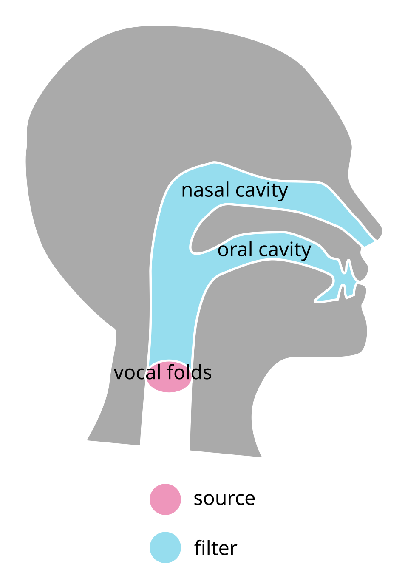
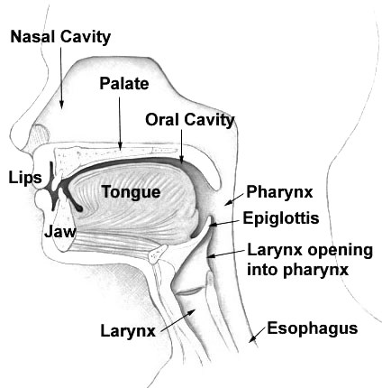

# 第一篇　导论：如何读懂五花八门的声乐术语

## 本篇要点

- 不同老师说法不一，主要有三个原因：流派不同、大量使用感觉描述、老师的个人经验不同。
- 理解任何声乐说法之前，先问一句：**它是在描述身体实际在做什么（机制描述），还是在描述做对时的感觉（感觉描述）？**
- 发声可以分为三个层面：**动力层**（呼吸）、**声源层**（声带）、**共鸣层**（声道）。几乎所有声乐概念都可以放进这张地图里定位。
- 很多常见术语（关闭、压缩、咽音、混声、头声）都有不止一种含义，只有先定位到地图上的某一层，才能判断别人说的是哪一种。

---

## 一、为什么说法五花八门

### 1. 流派不同，术语体系不同

声乐教学有许多体系，每个体系都有自己的一套术语。下面是你可能会接触到的几个：

| 体系 | 简介 | 代表性术语 |
|---|---|---|
| 美声（Bel Canto）传统 | 源自意大利的古典歌剧唱法，历史最长 | appoggio（支撑）、passaggio（换声区）、copertura（掩盖、关闭）、voce di petto / voce di testa（胸声、头声） |
| SLS（Speech Level Singing） | 美国声乐教师 Seth Riggs 创立，强调保持说话时的喉位 | chest / middle / head（胸声、中声、头声）、mix（混声） |
| Estill Voice Training | 美国嗓音研究者 Jo Estill 创立，把发声拆解成可以单独控制的解剖结构 | thick / thin folds（厚、薄声带）、twang（咽音）、false vocal fold retraction（假声带打开） |
| CVT（Complete Vocal Technique） | 丹麦声乐教师 Cathrine Sadolin 创立 | Neutral、Curbing、Overdrive、Edge 四种"模式" |
| 中国的教学传统 | 包括民族唱法、借鉴美声的教学，以及林俊卿先生的"咽音练声法" | 咽音、关闭、头腔共鸣、气沉丹田 |

同一个现象在不同体系里可能有完全不同的名字，同一个名字在不同体系里也可能指不同的现象。如果一位老师混用了几个体系的术语（这在实际教学中很常见），混乱就会加倍。

### 2. 大量使用感觉描述

很多声乐说法描述的是唱歌时的主观感受，而不是身体实际发生了什么。比如"把声音放到头腔""声音靠前""气沉丹田""打开喉咙"。这类说法对一部分人很有效，但因为每个人的感受不同，不同老师讲出来就五花八门。下一节会专门讨论这个问题。

### 3. 老师的个人经验不同

一位老师习惯用哪种讲法，往往取决于他自己的嗓音条件、他是怎么学会的，以及他教过的学生通常有什么问题。对他和他的很多学生有效的讲法，未必适合你。

---

## 二、工具一：机制描述与感觉描述

### 感觉的位置不等于动作的位置

人的**本体感觉**（身体感知自身位置和动作的能力）在喉咙内部很不精确。我们能比较清楚地感觉到舌头、嘴唇、下巴、软腭在做什么，但对声带、假声带、会厌附近发生的事情，几乎没有直接、准确的感觉。

结果就是，喉部的动作常常被感觉成发生在别的地方：小舌头附近、咽壁、后脑、眉心、鼻梁……振动也一样，低音时胸口有振动感，高音时头部和面部有振动感，但这并不意味着声音在那里产生或共鸣。

### 两类描述

| 类型 | 说的是什么 | 例子 |
|---|---|---|
| **机制描述** | 身体实际在做什么 | 声带闭合、会厌区收窄、喉头下降、软腭上提 |
| **感觉描述** | 做对时自己感觉到了什么，或用来引导动作的意象 | 咽壁收紧、声音放在面罩上、头腔共鸣、像打哈欠一样打开 |

感觉描述**并不是错的**。很多时候它在教学中反而更好用，因为人无法直接命令声带"闭合到 70%"，却可以模仿一种感觉。问题在于：

- 两位老师可能用**不同的感觉**描述**同一个动作**；
- 两位老师也可能用**同一个感觉**描述**不同的动作**；
- 同一个感觉提示，不同学生执行出来的动作可能完全不同。

所以，每遇到一个说法，先问自己：**这是在描述机制，还是在描述感觉？** 如果是感觉描述，就需要进一步追问：这个感觉背后，老师想要的实际动作是什么？

---

## 三、工具二：发声的三层地图

嗓音科学里有一个基础理论，叫**源—滤波理论**（source–filter theory），由瑞典语音学家 Gunnar Fant 在 1960 年系统提出。它把发声分为"声源"和"滤波器"两部分。再加上提供能量的呼吸，就得到了本文档使用的三层地图：

```text
共鸣层（声道）
    结构：喉咽、口咽、口腔、鼻腔
    作用：像滤波器一样加强或减弱某些频率
    决定：音色和元音
      ^
      |  原始声音向上进入声道
      |
声源层（声带）
    结构：声带
    作用：振动，产生原始声音
    决定：音高，以及基本的音质（厚或薄、虚或实）
      ^
      |  气流向上推动声带振动
      |
动力层（呼吸）
    结构：肺和呼吸肌
    作用：呼气，在声带下方形成气压（声门下压）
    决定：为振动提供能量，影响音量
```

<p align="center"></p>

*图 1-1　源—滤波模型示意图。声带（source）产生原始声音，口腔和鼻腔（filter）对声音进行塑形。*

<p align="center"></p>

*图 1-2　头颈部正中矢状切面。声音从喉（Larynx）里的声带发出，经过咽（Pharynx）、口腔（Oral Cavity）和鼻腔（Nasal Cavity）传出。会厌（Epiglottis）位于喉的入口上方。*

### 三层各管什么

**动力层：呼吸。** 肺部呼出的气流在声带下方形成气压，称为**声门下压**。这个气压是声带振动的能量来源。气压越大，通常音量越大。"气息""支撑""丹田"这些概念都属于这一层（第五篇详细讨论）。

**声源层：声带。** 两片声带在气流的推动下快速开合振动，每秒振动的次数就是音高。比如唱 A4 时，声带每秒振动约 440 次。声带的状态决定了原始声音的基本性质：厚还是薄，虚还是实。真声和假声、闭合和压缩这些概念属于这一层（第二、三篇）。

**共鸣层：声道。** 声带发出的原始声音很弱，听起来像"嗡嗡"声。它经过声带上方的管道（喉咽、口咽、口腔，有时还有鼻腔）时，某些频率被加强，某些被减弱，最终形成我们听到的音色和元音。喉头高低、咽腔宽窄、舌位、口型、软腭的位置都会改变这个"滤波器"的形状。咽音、美声的"关闭"、元音调整这些概念属于这一层（第四篇）。

### 三层的关系：相对独立，又互相影响

三层可以**相对独立地调节**。比如，同样的音高（声源层），换一个元音（共鸣层），音色就变了；同样的元音，音量（动力层）也可以有大有小。

但三层**并非完全独立**。比如，声门下压要和声带闭合的程度相互平衡；声道的某些形状会反过来让声带更容易闭合（第四篇会讲到的咽音就是例子）。理解了每一层之后，再理解它们之间的相互作用，是这套文档的整体思路。

---

## 四、多义术语预告

下面这些术语在教学中经常出现，但每个都有不止一种含义。表中列出它们的主要含义，以及在哪一篇详细讨论。

| 术语 | 可能的含义 | 所在层面 | 详见 |
|---|---|---|---|
| 关闭 | ① 声带闭合 | 声源 | 第二篇 |
| | ② 美声的"掩盖"：换声区的元音和喉位调整 | 共鸣 | 第四篇 |
| 压缩 | ① 声门压缩：声带闭合度 | 声源 | 第二篇 |
| | ② 气息压缩：声门下压 | 动力 | 第二、五篇 |
| | ③ 以憋气感为提示的喉部阀门参与，伴随咽壁收紧的感觉 | 跨越声源和共鸣 | 第二篇 |
| 咽音 | ① 会厌区收窄（twang） | 共鸣 | 第四篇 |
| | ② 打开咽腔 | 共鸣 | 第四篇 |
| 混声 | 一种目标音色，生理上可以由不同方式实现 | 主要在声源，共鸣配合 | 第三、六篇 |
| 头声 | 女声的 M2；美声男高音换声区以上的声音；流行教学中男声的强化假声等 | 声源 | 第三篇 |
| 胸腔共鸣、头腔共鸣 | 振动感的位置，不是共鸣的实际位置 | 感觉描述 | 第三篇 |

---

## 小结

1. 声乐术语混乱的根源是：流派各有术语体系，教学中大量使用感觉描述，以及老师的个人经验不同。
2. 喉部的本体感觉很不精确，感觉到的位置不等于动作发生的位置。听到任何说法，先分辨它是**机制描述**还是**感觉描述**。
3. 发声分为**动力层**（呼吸）、**声源层**（声带）、**共鸣层**（声道）。三层相对独立，又互相影响。
4. 遇到多义术语时，先把它定位到地图上的某一层，再判断说的是哪种含义。

---

## 案例分析

> 以下是对学习者本人情况的分析，和正文理论分开。

**学习背景。** 男，学习声乐约半年，以线下跟老师学习为主，先后跟过几位不同的老师，同时也看网络课程。偏好音乐剧（接近美声）和流行音乐。

**困惑的来源。** 在高音练习中，"关闭""混声""咽音""压缩"这四个词被反复提及，但不同老师的说法不同，而且似乎互相重叠。用本篇的工具来看，困惑有两个来源：

1. **同一个词在不同老师那里含义不同。** 这四个词中有三个是多义词（见上方的多义术语表）。
2. **它们在解决同一个问题，只是切入点不同。** 唱高音时的核心难题是：既不"喊破"（太重、太挤），也不"虚掉"（漏气、翻成很弱的假声）。不同老师从地图上不同的层面下手，所以用了不同的词。

**定位你遇到的说法。**

- 你接触到的"关闭"，更接近美声里的含义，属于**共鸣层**的掩盖技术（第四篇）。
- 你的一位老师所说的"压缩"，指的是"咽壁收紧"，用"憋气"的感觉、发"喝"的声音或"狗喘气"来体会。这是一个典型的**感觉描述**，需要还原成机制才能理解，分析见第二篇的案例部分。

---

## 参考资料

- Fant, G. (1960). *Acoustic Theory of Speech Production*. Mouton. 源—滤波理论的经典著作。
- Sundberg, J. (1987). *The Science of the Singing Voice*. Northern Illinois University Press. 歌唱嗓音科学的入门经典。

## 图片来源

- 图 1-1：[Source-filter model diagram.svg](https://commons.wikimedia.org/wiki/File:Source-filter_model_diagram.svg)，作者 Emflazie，CC BY-SA 4.0。
- 图 1-2：[Illu01 head neck.jpg](https://commons.wikimedia.org/wiki/File:Illu01_head_neck.jpg)，公有领域。
