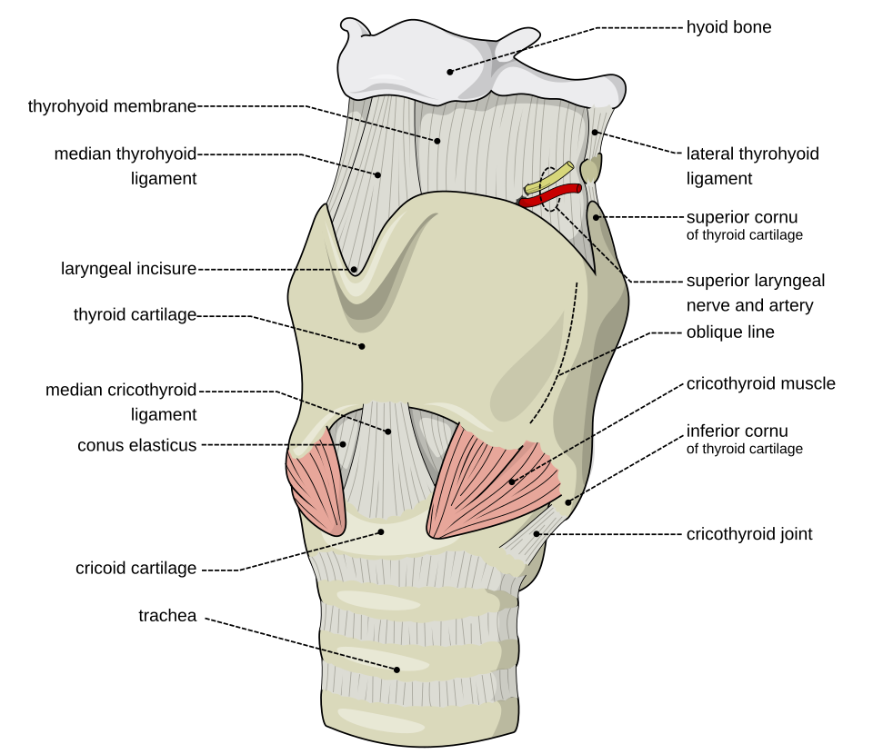
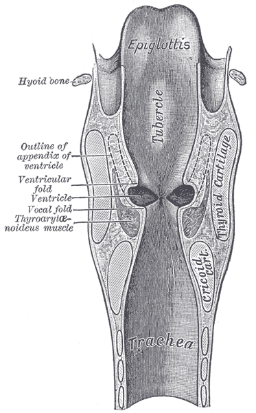
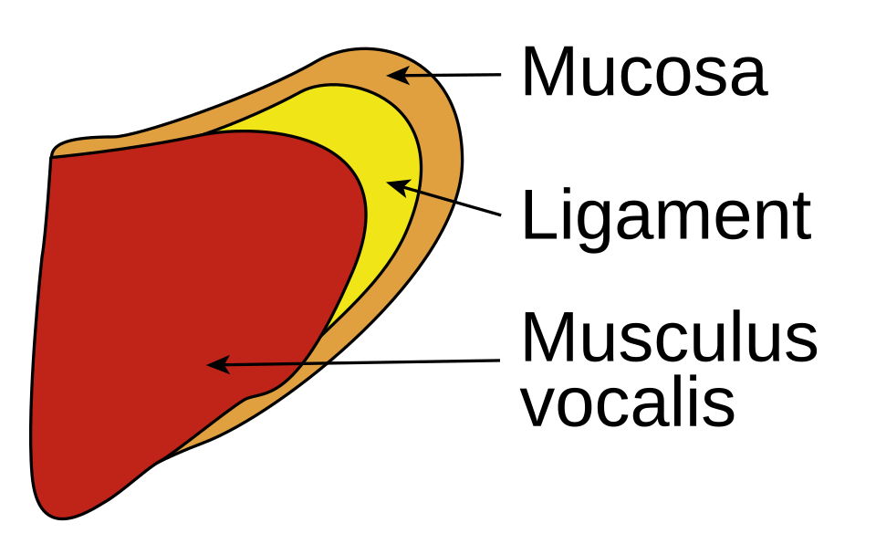
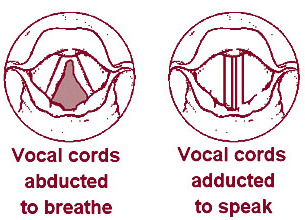
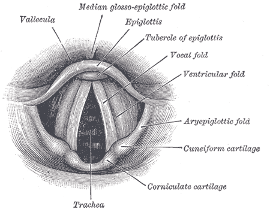
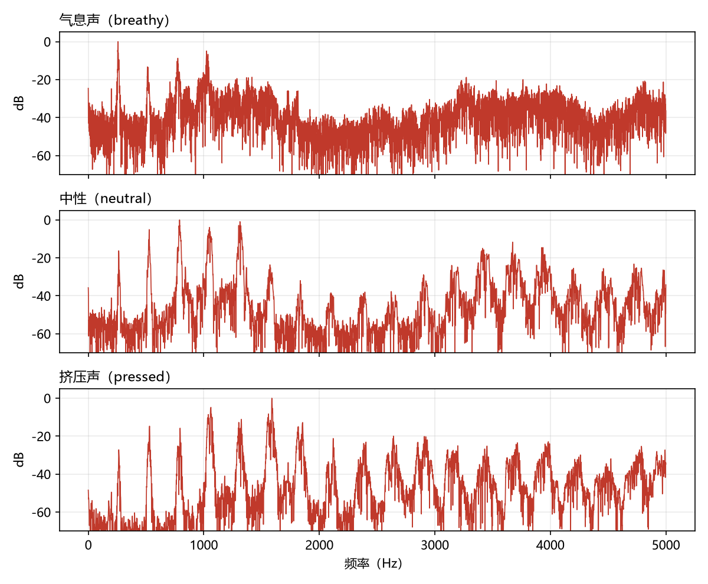
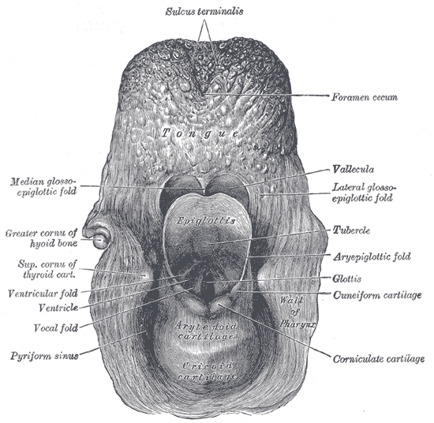

# 第二篇　声源（上）：声带与闭合

## 本篇要点

- 声带是一对位于喉内的组织，由里面的**肌肉（体）**和外面柔软的**黏膜（被覆）**组成。
- 声带振动不是靠肌肉一下一下地抽动，而是**气流推动**的；肌肉负责设定声带的长短、厚薄、松紧和位置。
- 控制声带的肌肉可以归纳为**两个旋钮**：**厚薄**（甲杓肌与环甲肌的力量对比）和**闭合度**（内收肌群让声带合得多紧）。两者相对独立，但有天然的联动。
- 闭合度是一个从**漏气**到**平衡**再到**挤压**的连续谱。
- 喉部是一个**三层的阀门**：真声带、假声带、杓会厌括约。唱歌理想的状态是第一层闭合、第二层打开、第三层适度收窄；**挤卡**通常意味着第二层也合拢了。
- "压缩"至少有三种含义，分属不同的层面。

---

## 一、喉：声带的"外壳"

声带位于**喉**（larynx）里面。喉是一组由软骨、肌肉和韧带组成的结构，位于气管顶端、咽的前下方。和唱歌关系最密切的几块软骨是：

| 软骨 | 位置和特点 |
|---|---|
| 甲状软骨 | 最大的一块，像一面向前合拢的盾牌。男性的"喉结"就是它的前端 |
| 环状软骨 | 在甲状软骨下方，形状像一枚戒指：前面窄，后面宽 |
| 杓状软骨 | 一对小软骨，坐在环状软骨后上方，可以转动和滑动 |
| 会厌 | 叶片状，位于喉的入口上方。吞咽时向后盖住喉口，防止食物进入气管 |

**声带的前端**附着在甲状软骨内侧（喉结的正后方），**后端**附着在杓状软骨上。所以，杓状软骨的转动和滑动决定了两片声带是分开还是合拢；甲状软骨和环状软骨之间的相对倾斜，决定了声带被拉得多长。

*图 2-1　喉的外观（前侧方视角）。从上往下依次是舌骨（hyoid bone）、甲状软骨（thyroid cartilage）、环状软骨（cricoid cartilage）和气管（trachea）。甲状软骨和环状软骨之间粉红色的扇形肌肉就是环甲肌（cricothyroid muscle），后面会讲到它负责把声带拉长。会厌和声带都在喉的内部，这个角度看不到。*

---

## 二、声带的结构

### 1. 从切面看声带和假声带

如果把喉从正面纵向切开，可以看到喉腔的两侧各有上下两道褶皱：

- **下面一对是声带**（vocal fold），也叫真声带，负责发声。
- **上面一对是假声带**（ventricular fold），也叫室带。它们比真声带更厚、更软，正常说话和唱歌时并不振动。
- 两者之间有一个小小的凹陷，叫**喉室**（ventricle）。

*图 2-2　喉的冠状切面（从正面纵向切开）。从上往下依次可以看到会厌（Epiglottis）、室带即假声带（Ventricular fold）、喉室（Ventricle）、声带（Vocal fold），以及声带内部的甲杓肌（Thyroarytaenoideus muscle）。*

这张图对理解后面的"三层阀门"非常重要：**假声带就在真声带的正上方**，中间只隔着一个小小的喉室。

### 2. "体—被覆"结构

日本喉科学者 Hirano（平野实）在 1970 年代提出，声带可以看作两层：

- **体**（body）：里面的肌肉，主要是**甲杓肌**的内侧部分（也叫声带肌）。它有一定的硬度，长度和紧张度可以由肌肉主动控制。
- **被覆**（cover）：外面的黏膜层，包括表层上皮和其下非常柔软、富有弹性的组织。它像一层松软的"果冻"，在振动中会像波浪一样滚动，称为**黏膜波**。

在体和被覆之间，还有一层由弹性纤维组成的**声韧带**，起过渡作用。

*图 2-3　一侧声带的切面示意。红色是声带肌（Musculus vocalis，即甲杓肌的内侧部分），也就是"体"；橙色是黏膜（Mucosa），也就是"被覆"；黄色是两者之间的声韧带（Ligament）。*

*图 2-4　声带振动的示意动画（冠状切面，左右两块分别是两侧声带，颜色含义同图 2-3）。注意声带开合时，下缘和上缘的动作有先后。*

"体—被覆"结构是理解第三篇"声区"的关键：真声和假声的本质区别，就在于"体"是否参与振动。

### 3. 声带是怎么振动的

声带振动**不是**靠肌肉每秒收缩几百次。唱 A4 时声带每秒振动约 440 次，肌肉根本不可能这么快地主动收缩。真实的过程是（这个解释被称为**肌弹性—空气动力学理论**）：

1. 肌肉先把两片声带拉到合拢或接近合拢的位置，并设定好长度和紧张度。
2. 呼出的气流被挡在声带下方，**声门下压**升高。
3. 气压升高到一定程度，把声带从下往上推开，气流冲出。
4. 气流通过后，下方气压下降，加上声带组织自身的弹性，声带重新合拢。
5. 循环往复，形成持续的振动。

在这个过程中，声带的**下缘先开、上缘后开，下缘先合、上缘后合**（图 2-4 的动画可以看到这一点）。这种上下的时间差叫**垂直相位差**，它让气流能持续地把能量传给声带，是振动能够自我维持的关键。

可以把它类比成：用嘴唇吹出"噗噜噜"的嘟唇声时，嘴唇的振动也不是嘴唇肌肉一下一下抽动的，而是气流吹动的；嘴唇肌肉只负责保持合适的松紧和位置。

**结论：肌肉负责"设定状态"，气流负责"驱动振动"。** 所以声带的厚薄、闭合度这些"状态"，和气息的大小，是两件需要相互配合的事。

---

## 三、控制声带的肌肉：两个旋钮

### 1. 主要的喉内肌

| 肌肉 | 作用 | 对声音的影响 |
|---|---|---|
| **甲杓肌**（thyroarytenoid，简称 TA） | 收缩时使声带**变短、变厚**，同时帮助声带内侧压紧 | 声音变厚、变实，偏"真声"的感觉 |
| **环甲肌**（cricothyroid，简称 CT） | 使甲状软骨和环状软骨之间的角度改变，把声带**拉长、拉薄**，张力增大 | 音高上升，声音变薄、变轻 |
| **环杓侧肌**（lateral cricoarytenoid）和**杓间肌**（interarytenoid） | 转动和拉拢杓状软骨，使两片声带**合拢**（内收） | 决定声带闭合的程度 |
| **环杓后肌**（posterior cricoarytenoid） | 唯一能让声带**分开**（外展）的肌肉，吸气时打开声门 | 吸气、换气 |

环甲肌可以在图 2-1 中看到（甲状软骨和环状软骨之间的扇形肌肉）；甲杓肌可以在图 2-2 中看到（声带内部标为 Thyroarytænoideus muscle 的部分）。

*图 2-5　从上往下看声带。左图：声带分开（外展），用于呼吸；右图：声带合拢（内收），用于发声。*

### 2. 归纳为两个旋钮

对于理解唱歌来说，这些肌肉的作用可以归纳为两个旋钮：

**旋钮一：厚薄。** 由**甲杓肌和环甲肌的力量对比**决定。甲杓肌占优势时，声带短而厚，振动时整块参与，声音厚实；环甲肌占优势时，声带长而薄，振动的部分变少，声音轻薄。这个旋钮和音高、声区密切相关，第三篇详细讨论。

**旋钮二：闭合度。** 主要由**内收肌群**（环杓侧肌、杓间肌）决定，甲杓肌也有贡献。它决定两片声带合得多紧，下一节详细讨论。

**两个旋钮相对独立。** 声带可以厚而漏气（比如慵懒的低声说话），也可以薄而闭合很紧（比如训练有素的歌手结实的高音）。

**但两个旋钮之间有天然的联动。** 因为甲杓肌既让声带变厚，又帮助声带内侧压紧，所以**声带越厚，往往越容易闭合；声带越薄，闭合越容易变差**。这就是为什么很多人一往高处唱、声带一变薄，声音就发虚。要在声带变薄的同时保持闭合，需要专门的协调能力。

### 3. 从喉镜里看声带

*图 2-6　用喉镜从上往下看到的喉内部（示意图）。图中声带处于分开的状态（呼吸时），中间露出气管（Trachea）。从中间往外依次是：声带（Vocal fold，白色的两条）、室带即假声带（Ventricular fold）、杓会厌襞（Aryepiglottic fold）。上方是会厌（Epiglottis）。*

---

## 四、闭合度：从漏气到挤压

### 1. 什么是闭合度

闭合度描述的是两片声带在振动中合得有多紧。它包括两个方面：

- **能不能完全合上**：如果每次振动时声带之间都留着一条缝，就会有一部分气流不经振动直接漏出去，形成"气声"。
- **合上的时间有多长**：在每一个振动周期里，声带闭合的时间所占的比例，叫做**闭合商**（closed quotient）。闭合商越高，每个周期里声带"关着"的时间越长。

### 2. 闭合度的连续谱

瑞典嗓音科学家 Sundberg 等人把闭合度从低到高分为几种典型状态：

| 状态 | 声带 | 声音特点 |
|---|---|---|
| **气息声**（breathy） | 闭合不完全或闭合时间很短，有气流泄漏 | 虚、柔、有明显的气声，泛音弱，音量小，费气 |
| **流畅发声**（flow phonation） | 闭合充分，但不过度 | 清晰、明亮、响亮，泛音丰富，省气，振动自由 |
| **挤压声**（pressed） | 闭合过紧，气流受阻 | 紧、扁、"卡"，振动受限，容易疲劳 |

这三者之间是**连续过渡**的，并不是三个分开的档位。

### 3. 闭合度为什么影响音色

声带每次快速合拢，相当于把气流"突然切断"一次。切断得越干脆、越完全，产生的高频泛音就越丰富，声音就越明亮、越有"芯"。如果声带合不严，气流一直在漏，切断就不干脆，高频泛音减少，还会混入气流的噪音，声音就发虚。

但闭合也不是越紧越好。闭合过紧时，声门下压需要更大才能推开声带，声带的振动也会变得僵硬，声音就从"实"变成了"挤"。

### 4. 听一听：真人录音中的三档闭合度

下面三段录音来自英国研究者 Proutskova 公开的"发声方式数据集"（Phonation Modes Dataset）：同一位女歌手在 C4 上用元音 a 唱长音，分别以气息声、中性、挤压声三种方式演唱。标签是录制时由研究者指定的，而不是事后判断的。

有两点说明：

- 数据集里还有一档"流畅发声"，但作者本人说明，这部分录音并不符合 Sundberg 原本的定义，所以这里不采用。
- 根据作者的记录，挤压声是通过**抬高喉头**来实现的。这也印证了第四篇会讲到的：喉头上提常常和挤压绑在一起。

三段录音使用同一个音量系数，保留了原始录音之间的响度差别。

<audio controls src="audio/ch2-phonation-breathy.mp3"></audio>

*音频 2-1　气息声（breathy）。*

<audio controls src="audio/ch2-phonation-neutral.mp3"></audio>

*音频 2-2　中性（neutral）。*

<audio controls src="audio/ch2-phonation-pressed.mp3"></audio>

*音频 2-3　挤压声（pressed）。*

*图 2-8　三段录音的实测频谱。每一个尖峰是一个泛音。气息声的泛音之间被气流噪声填满，高频部分几乎全是噪声；中性的泛音清晰；挤压声的基频（最左边的尖峰）最弱，而高频泛音又多又清楚。*

对这三段录音的测量结果，和上面讲的规律一致：

- 衡量嗓音"干净"程度的指标（倒谱峰值突出度，数值越高，周期性越强、噪声越少）依次约为 16、25、29 dB。气息声明显最低，因为有大量漏气的噪声。
- 基频相对于最强泛音的强度依次约为 0、−19、−24 dB。闭合越不充分，基频越突出；闭合越紧，能量越往高频泛音转移。

### 5. 闭合度需要和气息平衡

声带闭合产生阻力，呼出的气流产生压力，两者需要平衡：

- **闭合不足、气息多**：漏气，声音虚。
- **闭合和气息平衡**：振动自由、高效。
- **闭合过度、气息也猛**：挤压、喊叫。

这就是动力层和声源层之间的联系，第五篇讨论"支撑"时会再展开。

### 6. "关闭"的第一种含义

在流行唱法的教学中，"关闭"常常指的就是**声带闭合**，比如"声带要关闭好""闭合不够所以漏气"。这时它和"压缩"的第一种含义（声门压缩）是同义词。美声中的"关闭"是完全不同的概念，属于共鸣层，在第四篇讨论。

---

## 五、喉部是一个三层的阀门

### 1. 喉的原始功能不是发声

从生物学上说，喉最原始的功能**不是发声**，而是：

- **保护气道**：吞咽时关闭，防止食物和水进入气管。
- **憋住气压**：在搬重物、用力咳嗽、排便、分娩时关闭，把气憋在胸腔里，让躯干变得坚固，便于发力。

为了完成这些功能，喉部有**三层可以关闭的结构**，从下往上依次是：

| 层级 | 结构 | 唱歌时的理想状态 |
|---|---|---|
| 第一层 | **真声带** | 闭合，负责发声 |
| 第二层 | **假声带** | 打开 |
| 第三层 | **杓会厌括约**：由杓会厌襞、会厌和杓状软骨共同构成的"领口" | 适度收窄，这就是咽音（twang）的来源 |

*图 2-7　从后上方看喉的入口。会厌（Epiglottis）和两侧的杓会厌襞（Aryepiglottic fold）围成一个"领口"，这就是第三层阀门。往里看可以看到室带即假声带（Ventricular fold）和声带（Vocal fold）。*

结合图 2-2（冠状切面）和图 2-6（喉镜视角）可以看到，这三层结构是上下叠在一起的，彼此离得很近。

### 2. 憋气的程度不同，关闭的层数也不同

- **轻轻憋住一口气**：基本只有真声带闭合。
- **用力憋住**（比如搬重物）：假声带也合拢，压在真声带上方。
- **最大力度**（比如憋着劲举极重的东西）：第三层也收紧，会厌和杓状软骨向中间靠拢，整个喉部像拳头一样攥住。

身体天然地把这三层当作**一套整体机制**来用：越用力，越多层一起关闭。

### 3. 唱歌要求部分违背身体的原始习惯

唱歌的理想状态是：**第一层闭合，第二层打开，第三层根据需要适度收窄**。也就是说，要把身体原本"打包"在一起的动作拆开，只用其中一部分。这不是天生就会的，需要长期训练。

这也解释了高音容易挤卡的根本原因：音越高，往往需要更大的声门下压和更好的闭合，身体就越倾向于启动"用力憋气"的整套反应，把假声带也一起关上。

### 4. 挤卡在喉部发生了什么

"挤卡"在嗓音科学中常被称为**声门上挤压**（supraglottic constriction），意思是声带上方的结构在收紧。它通常包括：

- **假声带向中间合拢**：压在真声带上方，限制了真声带的振动，声音发紧、发闷。
- **第三层收得过紧**：超过了咽音所需的"适度收窄"。

挤卡时还常常伴随喉头上提、舌根后缩等声道层面的动作，这些在第四篇讨论。

### 5. 和咽音的关系（预告）

咽音（twang）的本质是第三层阀门的**适度**收窄，同时第二层（假声带）保持打开。它能让声音明显变亮、变响，并且有助于真声带闭合。也就是说，**咽音和挤卡用到的是同一套阀门，区别在于程度，以及假声带有没有被一起带进来**。第四篇会详细讨论咽音的声学原理。

---

## 六、"压缩"的三种含义

到这里，可以把"压缩"这个词在教学中的几种用法整理清楚：

| 含义 | 所在层面 | 本质 | 用法举例 |
|---|---|---|---|
| ① 声门压缩 | 声源 | 声带闭合度，主要由内收肌群决定 | "高音要保持压缩，不然会虚" |
| ② 气息压缩 | 动力 | 声带下方的气压，以及维持这个气压的呼吸肌活动 | "气息要压缩住，不要一下子放掉" |
| ③ 以憋气感为提示的喉部阀门参与 | 跨越声源和共鸣 | 借用憋气的阀门机制获得闭合感，常伴随"咽壁收紧"的感觉 | "像憋气一样收紧咽壁" |

三者都与"闭合"和"阻力"有关，所以常被混在一起使用。第三种是一个感觉描述，它调用的阀门机制既能带来良好的闭合（第一层），也可能在做得过重时带来挤卡（第二层）。

---

## 小结

1. 声带由**体**（肌肉）和**被覆**（黏膜）组成，上方紧挨着**假声带**。
2. 声带振动是**气流驱动**的，肌肉负责设定状态。
3. 控制声带的肌肉可以归纳为两个旋钮：**厚薄**（甲杓肌对环甲肌）和**闭合度**（内收肌群）。两者相对独立，但声带越薄，闭合越容易变差。
4. 闭合度是从**气息声**到**流畅发声**再到**挤压声**的连续谱，并且需要和声门下压平衡。
5. 喉部是**三层阀门**：真声带、假声带、杓会厌括约。唱歌要求第一层闭合、第二层打开、第三层适度收窄。挤卡常常是第二层也合拢了。
6. "关闭"的第一种含义是声带闭合；"压缩"至少有三种含义，分属声源层、动力层，以及跨层的感觉提示。

---

## 案例分析

> 以下是对学习者本人情况的分析，和正文理论分开。

### 1. 你描述的问题

唱高音时最主要的问题是**容易挤卡**。你自己分析的可能原因有：

1. 喉部肌肉介入发力过多，导致声带压力较大；
2. 舌头后缩；
3. 在掌握了一定的咽音技巧之后，当喉部和舌头相对能够控制、管道通畅时，高音又容易**闭合不足**，声音发虚，拉不住。

### 2. 用本篇的理论来分析

**挤卡时**，按照三层阀门的模型，很可能同时发生了这几件事：

- 声带太厚：带着过多的甲杓肌力量进入高音（第三篇会从声区的角度进一步分析）。
- 声门上挤压：假声带合拢，第三层也收得过紧。这对应你说的"喉部肌肉介入过多"。
- 喉头上提、舌根后缩：属于声道层面的代偿（第四篇讨论）。

**放松之后发虚**，是因为上面那些动作被你成功去掉了，但它们原本在"帮"声带闭合。也就是说，**你原先的闭合有一部分是靠声门上挤压"借来的"**。当声带在高音区变薄、按"两个旋钮的联动"闭合天然变差时，声带自身的闭合能力还不足以单独维持，于是声音发虚。

所以你现在在两种失败模式之间来回摆：要么"实"但挤，要么"松"但虚。理论上的目标是第三种状态：**第一层（真声带）是实的，第二层（假声带）是开的**，即"声带层实，上方空"。

### 3. 分析你老师所说的"压缩"

你的一位老师所说的"压缩"，指的是**小舌头附近的肌肉收紧**，类似**憋气**的感觉，可以通过发类似**"喝"的声音**或**"狗喘气"**来感受咽壁的发力和收缩。

用第一篇的"机制描述与感觉描述"和本篇的"三层阀门"来分析：

- **"类似憋气的感觉"**：调用的就是喉部的阀门机制。好处是能让你体会到"闭合"是什么感觉，正好能补上你放松后闭合不足的问题。风险在于憋气感一旦做重了，第二层的假声带会跟着合拢，变成挤卡。同一个提示，做轻和做重是两种完全不同的结果。
- **"小舌头附近收紧"**：这是**感觉到的位置**。由于喉部的本体感觉不精确，你感觉到的未必是那里真正在发生的动作。实际上可能是软腭和上咽壁的肌肉在用力（这会影响音色，但和声带闭合关系不大），也可能是喉部第一层或第三层的动作被感觉成了"小舌头附近"，或者两者同时发生。
- **"喝"的声音**：普通话"喝"的声母 h 是舌根和软腭之间摩擦发出的，所以它会把注意力引向口腔后部和小舌头附近，这可能是感觉位置在那里的原因。如果像练武时那样有力地喊一声"喝！"，还会伴随明显的声门闭合，也是在调用阀门机制。值得留意的是，发"喝"时舌头后部会向后上方抬起，如果这个动作被带进唱歌，**可能**和你提到的舌根后缩有关。这只是一种可能，需要老师现场判断。
- **"狗喘气"**：在中文教学中常用来让人感觉到咽后壁的存在（快速呼吸时气流让咽后壁有凉的感觉），以及咽壁有张力、"站立"起来的状态。它更多是帮助定位这个部位，本身不是一个具体的发声动作。

**总结：** 你老师的"压缩"可以理解为"借用憋气的阀门机制来获得闭合感，同时用咽壁有张力的感觉来定位"，属于上面"压缩"三种含义中的第三种。理论上它想要的是第一层闭合加第三层适度收窄。能不能做对，关键在于程度，以及第二层有没有被一起带进来。

---

## 参考资料

- Hirano, M. (1974). Morphological structure of the vocal cord as a vibrator and its variations. *Folia Phoniatrica*, 26(2), 89–94. "体—被覆"模型的来源。
- Titze, I. R. (2000). *Principles of Voice Production* (2nd printing). National Center for Voice and Speech. 声带振动原理的权威教材。
- Gauffin, J., & Sundberg, J. (1989). Spectral correlates of glottal voice source waveform characteristics. *Journal of Speech and Hearing Research*, 32(3), 556–565. "流畅发声"概念的来源之一。
- Proutskova, P., Rhodes, C., Wiggins, G., & Crawford, T. (2012). Breathy or resonant: A controlled and curated dataset for phonation mode detection in singing. *Proceedings of the 13th International Society for Music Information Retrieval Conference (ISMIR 2012)*. 音频 2-1 至 2-3 的来源数据集。
- Edmondson, J. A., & Esling, J. H. (2006). The valves of the throat and their functioning in tone, vocal register and stress: laryngoscopic case studies. *Phonology*, 23(2), 157–191. 关于喉部多层阀门的喉镜研究。
- Estill Voice Training 体系中关于假声带打开（false vocal fold retraction）和杓会厌括约收窄（twang）的论述。

## 图片来源

- 图 2-1：[Larynx external en.svg](https://commons.wikimedia.org/wiki/File:Larynx_external_en.svg)，作者 Olek Remesz，CC BY-SA 2.5。
- 图 2-2：[Gray954.png](https://commons.wikimedia.org/wiki/File:Gray954.png)，《格氏解剖学》（Gray's Anatomy, 1918），公有领域。
- 图 2-3：[Vocal fold scheme.svg](https://commons.wikimedia.org/wiki/File:Vocal_fold_scheme.svg)，作者 Fred the Oyster，CC BY-SA 4.0。
- 图 2-4：[Vocal fold animated.gif](https://commons.wikimedia.org/wiki/File:Vocal_fold_animated.gif)，作者 Reinhard，公有领域。
- 图 2-5：[Illu07 larynx02.jpg](https://commons.wikimedia.org/wiki/File:Illu07_larynx02.jpg)，公有领域。
- 图 2-6：[Gray956.png](https://commons.wikimedia.org/wiki/File:Gray956.png)，《格氏解剖学》，公有领域。
- 图 2-7：[Gray955.png](https://commons.wikimedia.org/wiki/File:Gray955.png)，《格氏解剖学》，公有领域。
- 音频 2-1 至 2-3：Proutskova, P. (2012). [Phonation modes dataset](https://osf.io/pa3ha)，文件 1811、1821、1841（C4，元音 a），授权 CC BY-NC-SA。本书对原始录音做了淡入淡出和格式转换，处理后的音频沿用相同授权。
- 图 2-8：本书根据音频 2-1 至 2-3 绘制，生成脚本为 [`scripts/vocal-theory/make_real_clips.py`](../scripts/vocal-theory/make_real_clips.py)。
