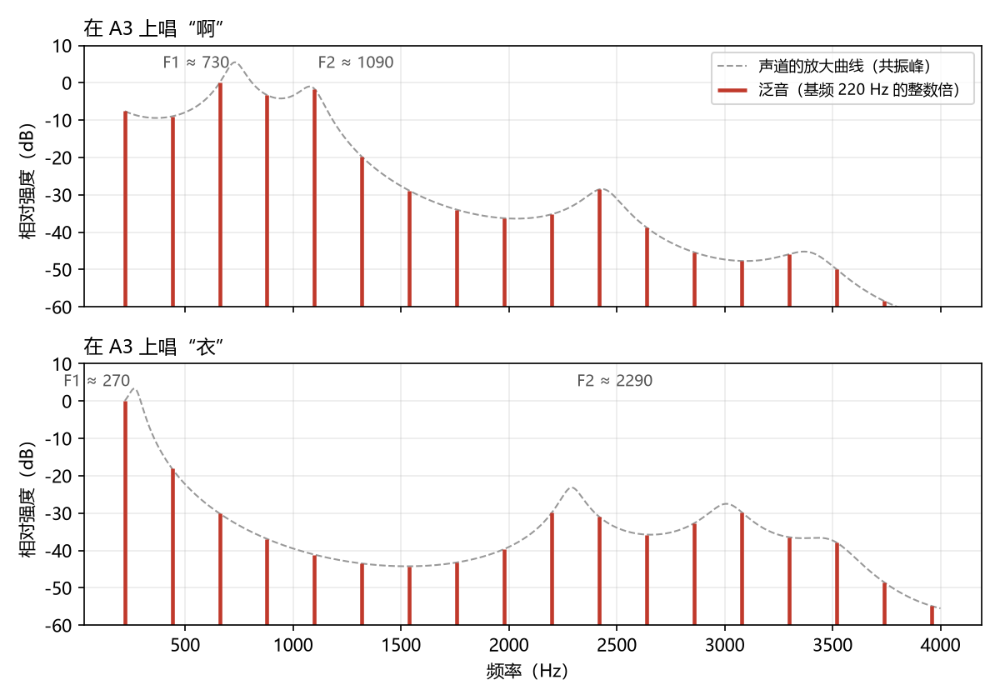
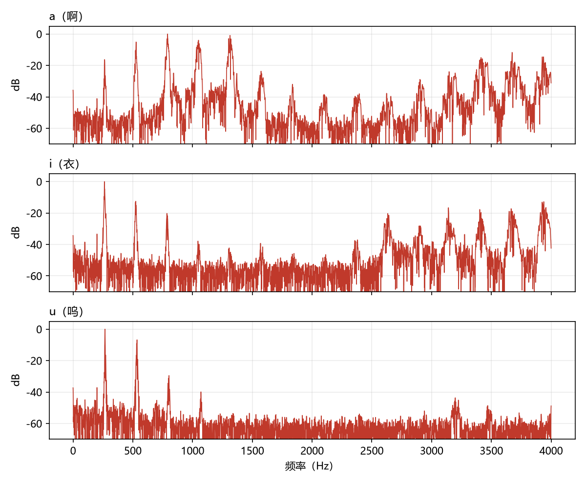
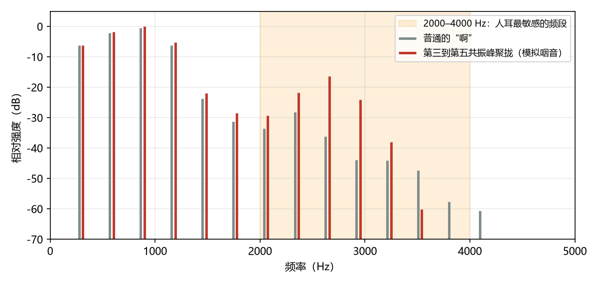
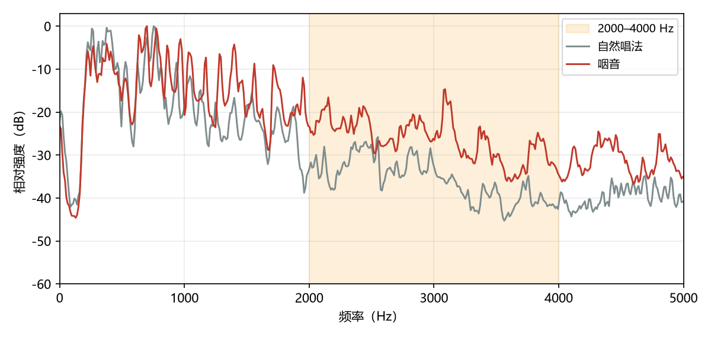
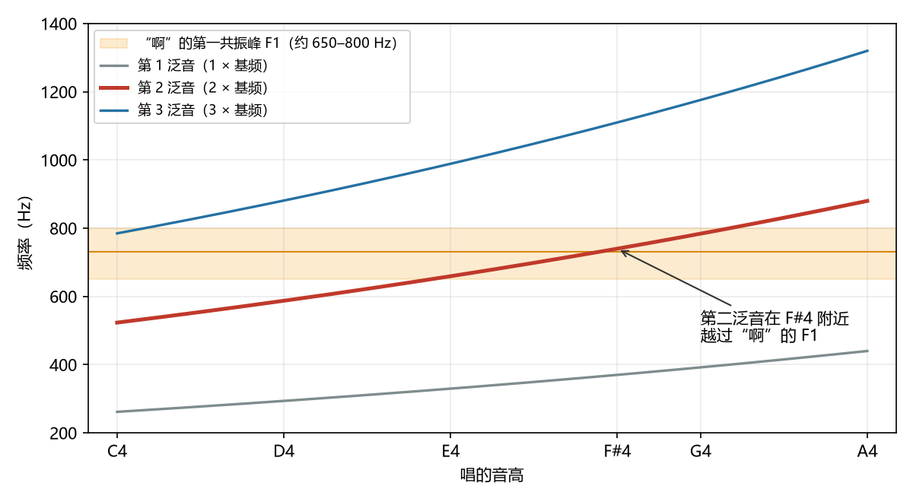
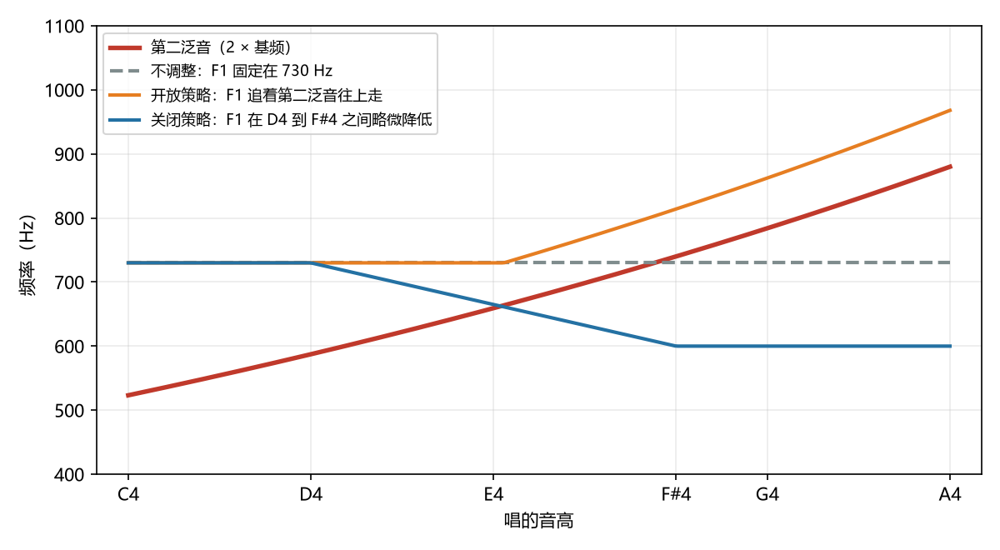
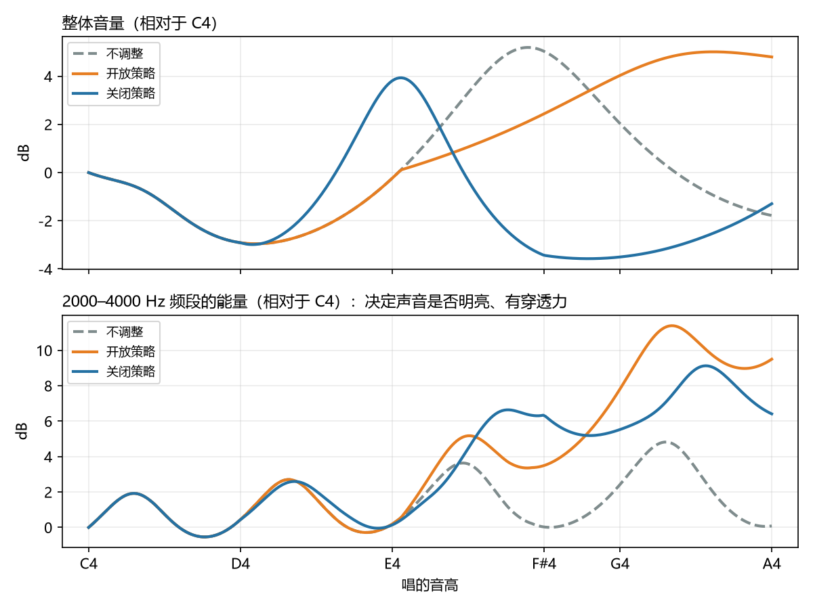

# 第四篇　共鸣：共振峰、元音与换声区

## 本篇要点

- 声带发出的声音由**基频**和一串**泛音**组成。基频决定音高，完全由声带决定；共鸣不会改变音高。
- 声道像一个**会随时变化的均衡器**：它有几个特别"友好"的频率区域，叫**共振峰**。靠近共振峰的泛音被放大，远离的被减弱。
- **元音就是共振峰的组合**。第一共振峰（F1）主要和开口度有关，第二共振峰（F2）主要和舌头前后有关。
- 共振峰对唱歌有四个具体影响：决定元音、决定音色、决定响亮程度和省力程度、决定高音区唱起来顺不顺。
- **咽音**和**歌手共振峰**都来自会厌区的收窄，它们把能量集中到人耳最敏感的 2000 到 4000 赫兹。
- 男声在 E4 到 G4 之间，第二泛音会越过元音"啊"的第一共振峰。面对这次交叉有两种策略：**开放策略**（belt 的方向）和**关闭策略**（美声的方向）。"喊"是开放策略的失败版本，"捂"是关闭策略的失败版本。

> 本篇的音频分两类：
>
> - **真人录音**：来自公开授权的研究数据集，标签由原研究者或歌手在录制时指定。放进文档之前都做过测量，确认测量结果和文中的说法一致。
> - **合成音频**：先生成一串泛音模拟声带，再用共振峰滤波器模拟声道。声音听起来很机械，但物理过程完全受控，能保证演示的就是文中说的那件事。合成时只改变了声道，没有改变声带，所以它只能演示共鸣层的原理。凡是找不到合适真人录音的地方（比如换声区的三种处理方式），就只用合成音频。生成脚本见仓库的 [`scripts/vocal-theory`](../scripts/vocal-theory/) 目录。

---

## 一、基频和泛音：声源提供的"原料"

声带振动产生的不是一个单纯的频率，而是一组频率：

- **基频**：声带每秒振动的次数，决定我们听到的音高。比如唱 A3，基频是 220 赫兹。
- **泛音**（也叫谐波）：基频的整数倍。唱 A3 时，泛音是 440、660、880、1100 赫兹……一直延伸到几千赫兹。

基频决定"唱的是哪个音"，泛音的强弱分布决定"听起来是什么音质"。第二篇讲过，声带闭合越干脆，高频泛音越丰富。所以，**声源层提供的是"原料"：一串等间距的泛音，间距正好等于基频。**

---

## 二、共振峰：声道是一个活的均衡器

从声带到嘴唇的这段管道就是**声道**，成年男性大约 17 厘米长。像所有管子一样，它对某些频率特别"友好"：接近这些频率的泛音会被加强，远离的会被减弱。这些被加强的频率区域叫**共振峰**，从低到高依次称为第一共振峰（F1）、第二共振峰（F2）、第三共振峰（F3）……

一根粗细均匀、约 17.5 厘米长的管子，共振峰大约在 500、1500、2500 赫兹。真实的声道粗细不均，而且形状一直在变，所以共振峰的位置也一直在变。女声和儿童的声道更短，共振峰整体更高。

可以把声道想象成音乐播放器里的**均衡器**（EQ）：

- 歌曲的旋律对应声带决定的音高。不管怎么调均衡器，旋律都不会变。
- 均衡器可以加强某些频段、减弱另一些频段，让同一首歌听起来更闷或更亮。这对应声道塑造的音色。
- 不同之处在于，声道这个均衡器是**活的**：你每动一下舌头、嘴唇、下巴、喉头，它的设置就变一次。

有两点很重要：

1. **共振峰不产生能量。** 它只是对声带送来的泛音进行"筛选"和"放大"。这就是第一篇里源—滤波理论的含义。
2. **"共鸣"指的是声道的形状，而不是某个腔体在"嗡嗡响"。** 改变共鸣，就是改变这根管子的长短和各处的粗细。

---

## 三、元音就是共振峰的组合

### 1. 元音由 F1 和 F2 决定

我们之所以能分辨"衣""啊""呜"，靠的主要是**第一和第二共振峰的位置**。下面是美国成年男性的典型数值（Peterson 与 Barney，1952），汉语的对应元音大致相近：

| 元音 | F1（赫兹） | F2（赫兹） |
|---|---|---|
| i（衣） | 约 270 | 约 2290 |
| ɛ（接近"耶"里的 e） | 约 530 | 约 1840 |
| ɑ（啊） | 约 730 | 约 1090 |
| ɔ（接近"哦"） | 约 570 | 约 840 |
| u（呜） | 约 300 | 约 870 |

可以看出两条大致的规律：

- **F1 主要和开口度有关**：嘴张得越大、舌位越低，F1 越高。"啊"的 F1 最高，"衣"和"呜"最低。
- **F2 主要和舌头前后有关**：舌头越靠前，F2 越高。"衣"最高，"呜"和"哦"最低。

### 2. 同一个音高，不同的元音

假设在 A3（基频 220 赫兹）上先唱"啊"，再唱"衣"。两次的音高完全一样，声带送出的泛音也一样，但被放大的泛音不同：

*图 4-1　在 A3 上唱"啊"（上）和"衣"（下）。红色竖线是各个泛音，它们的位置完全相同（都是 220 赫兹的整数倍）；灰色虚线是声道的放大曲线，峰值就是共振峰。唱"啊"时，660 到 1100 赫兹附近的泛音最强；唱"衣"时，基频本身最强，另外 2200 赫兹附近的泛音也被放大。*

<audio controls src="audio/ch4-01-vowels-same-pitch.mp3"></audio>

*音频 4-1（合成）　在 A3 上依次唱"啊""衣""呜"。音高始终不变，只有共振峰在移动。*

下面是真人录音：同一位女歌手在 C4（约 262 赫兹）上，依次用中性发声唱 a、i、u 三个长音，来自第二篇用过的发声方式数据集。

<audio controls src="audio/ch4-real-vowels.mp3"></audio>

*音频 4-2（真人）　女歌手在 C4 上依次唱 a、i、u。*

*图 4-2　音频 4-2 的实测频谱，每个尖峰是一个泛音（间隔约 262 赫兹）。a：最强的泛音在 790 到 1320 赫兹之间，说明 F1 较高（开口大）。i：基频本身最强（F1 很低），同时 2600 到 4000 赫兹又有一组明显的泛音（F2 很高，舌头靠前）。u：基本只有最低的两三个泛音，1100 赫兹以上几乎没有能量（F1 和 F2 都很低）。这和上面表格里的规律一致；女声的声道比男声短，所以具体数值整体偏高。*

### 3. 证据：耳语

耳语时声带根本不振动，没有音高，但你依然能分辨出元音。因为声道的形状仍然在塑造气流的噪音。这直接说明了**元音来自共振峰，而不是声带**。

<audio controls src="audio/ch4-02-whisper.mp3"></audio>

*音频 4-3（合成）　用噪音代替声带振动，再经过同样的共振峰滤波，得到耳语般的"啊""衣""呜"。*

另一个有趣的例子是蒙古族的**呼麦**：歌手保持基频不变，通过精细地移动共振峰，让某一个泛音特别突出，听起来就像在同一个低音之上又唱出了一条高音旋律。

---

## 四、共振峰对唱歌的四个具体影响

**1. 决定元音，也就是咬字。** 如上所述。

**2. 决定音色。** 同样唱"啊"，喉头下降、嘴唇收圆时，共振峰整体降低，声音偏暗、偏圆；嘴角展开、喉位偏高时，共振峰升高，声音偏亮、偏薄。"亮""暗""圆""扁""靠前""靠后"这些音色描述，大多是在说共振峰的位置。

**3. 决定响亮程度和省不省力。** 如果某个较强的泛音正好落在共振峰上，它会被大大放大，声音就更响，而声带并没有多用力。这就是"共鸣好"的人听起来很响、自己却觉得省力的原因。

**4. 在高音区，决定唱起来顺不顺。** 泛音之间的间隔等于基频：

- 唱**低音**时，比如 A2（110 赫兹），泛音很密，每隔 110 赫兹就有一个。不管共振峰在哪里，附近总有泛音可以放大，所以低音很少有"共鸣问题"。
- 唱**高音**时，比如 G4（392 赫兹），泛音变得很稀，每隔将近 400 赫兹才有一个。这时某个泛音**是否恰好落在共振峰附近**就变得非常关键。
- 随着音高升高，泛音会一个个**越过**共振峰。每越过一次，被放大的泛音就会突然换一个，音色会跟着突变，唱的人也会觉得原本顺的状态突然"不对了"。

所以，**共振峰不改变音高，但音高会改变泛音和共振峰之间的关系。** 第七节会详细讨论这一点。

---

## 五、声道的调节旋钮

*图 4-3　头颈部正中矢状切面（同图 1-2）。声道从喉（Larynx）开始，经过咽（Pharynx），再分成口腔（Oral Cavity）和鼻腔（Nasal Cavity）两条通道。软腭位于硬腭（Palate）后端，决定鼻腔通道是否打开。*

改变声道形状的部位主要有下面几个：

| 部位 | 怎么变 | 对共振峰和音色的影响 |
|---|---|---|
| **喉位** | 喉头下降，声道变长；喉头上升，声道变短 | 下降：共振峰整体降低，声音更暗、更圆。上升：共振峰升高，声音更亮、更薄 |
| **嘴唇** | 收圆、前突，声道变长；嘴角展开，声道变短 | 收圆：更暗；展开：更亮 |
| **下颌和开口** | 张大或闭小 | 主要影响 F1，张得越大 F1 越高 |
| **舌头** | 前后、高低，以及舌根的位置 | 主要影响 F1 和 F2，也就是元音本身 |
| **软腭** | 上抬时关闭通往鼻腔的通道；下垂时打开 | 下垂时鼻腔参与，带上鼻音色彩 |
| **咽腔** | 扩大或收窄 | 扩大：声音更圆、更有"空间感" |
| **会厌区**（第二篇讲的第三层阀门） | 适度收窄 | 加强 2000 到 4000 赫兹的频段，也就是咽音，见第六节 |

有几个部位需要多说几句。

**喉位没有绝对的好坏。** 美声通常要求喉位相对低而稳定，所以音色偏圆、偏暗。流行和 belt 唱法常常保持说话时的喉位，甚至略高，所以音色更亮、更接近说话。真正的问题不在于喉位高低，而在于喉头上升时往往伴随喉外肌肉用力，这就和第二篇讲的挤卡联系在一起了。

**舌根后缩的影响有两层。** 在共鸣层面，它让口咽变窄，改变共振峰，声音会发闷、发"捂"。在生理层面，舌根通过舌骨和喉部相连，舌根往后、往下压，会给喉部带来额外的压力和干扰。

**"打开喉咙"其实是几个动作的组合。** 老师常用"打哈欠的感觉""吸着唱"来提示，对应的通常是软腭上抬、咽腔扩大、喉位下降。适度时，声音圆润、有空间感；过度时，就会变成压喉、发捂、声音太暗。

---

## 六、咽音和歌手共振峰

### 1. 歌手共振峰

瑞典嗓音科学家 Sundberg（1974）发现，受过训练的古典男歌手的声音里，在大约 2500 到 3000 赫兹处有一个特别强的能量峰，称为**歌手共振峰**。它的成因是：会厌区那一段短管道（喉的出口）明显比上方的咽腔窄，Sundberg 估计截面积大约不到咽腔的六分之一，于是第三到第五共振峰聚集在一起，形成一个强峰。

它的意义在于：交响乐队的能量主要集中在较低的频段，而人耳在 3000 赫兹左右最敏感。有了这个峰，歌手不用麦克风也能"穿透"整个乐队。

### 2. 咽音（twang）

咽音的本质是**会厌区的收窄**，也就是第三层阀门的适度收紧。它会显著加强 2000 到 4000 赫兹的频段，和歌手共振峰属于同一类现象，只是收窄得更明显，声音也更尖、更亮。

正因为人耳对这个频段最敏感，咽音带来的效果是：**不用更多的气、不用更大的力，听起来就更响、更亮、更有穿透力。** 咽音常被听成"鼻音"，但它和软腭是否下垂没有必然联系：软腭关闭时一样可以有很强的咽音。

*图 4-4　在 D4 上唱"啊"。灰色是普通的"啊"，红色是把第三到第五共振峰聚拢到 2500 到 3150 赫兹之后的"啊"（模拟会厌区收窄）。两者的低频部分几乎一样，但 2300 到 3300 赫兹附近的几个泛音被抬高了 6 到 20 dB，正好落在人耳最敏感的频段里。*

<audio controls src="audio/ch4-06-twang.mp3"></audio>

*音频 4-4（合成）　前半段是普通的"啊"，后半段只改变了第三到第五共振峰的位置。两段的声源和音量设置完全相同，注意听后半段是否显得更亮、更响。*

下面是真人录音，来自 GTSinger 歌唱数据集（NeurIPS 2024）。一位中文流行男高音用同样的旋律和歌词，分别以自然唱法和咽音演唱同一句歌词（"而承诺像尘埃，不断被时间掩埋"，旋律最高到 A#4）。"咽音"这个标签是录制时由歌手按自己的理解唱出来的，所以我对两段录音做了测量，确认它符合本节讲的咽音特征。

<audio controls src="audio/ch4-gts-pharyngeal-control.mp3"></audio>

*音频 4-5（真人）　自然唱法。*

<audio controls src="audio/ch4-gts-pharyngeal-twang.mp3"></audio>

*音频 4-6（真人）　咽音。*

*图 4-5　两段录音的长时平均频谱。1000 赫兹以下两条曲线几乎重合，说明音高和元音基本一致；从约 1500 赫兹往上，咽音版整体高出 8 到 10 dB。按能量计算，咽音版 2000 到 4000 赫兹的能量占比比自然版高约 9 dB。同一句歌词在数据集里还有另一组录音，测得的差值约为 8 dB，结果一致。*

两段录音使用同一个音量系数，所以也可以比较响度：咽音版整体只比自然版响约 1.4 dB，但听起来明亮得多。这正是咽音"不用更多的力，听起来就更亮、更有穿透力"的体现。

### 3. 为什么咽音能帮助闭合

这是声道反过来影响声源的一个例子。美国嗓音科学家 Titze（2008）的研究指出，会厌区变窄后，声道对声带振动产生一种"助推"效应（专业术语叫惯性抗），让声带更容易振动、更容易闭合。这就是很多老师喜欢在高音练习中使用咽音的声学原因：**同样的力气，可以得到更好的闭合和效率。**

（这种效应来自真实的气流和声带之间的相互作用，本篇的合成音频没有模拟它。）

### 4. "咽音"两种含义的统一

第一篇提到，"咽音"有时指会厌区收窄，有时指打开咽腔，两者方向看似相反。现在可以看清楚：歌手共振峰需要的正是**"下面窄、上面宽"**，也就是会厌区窄、咽腔宽。两者发生在不同的位置，可以同时存在，而且同时存在时效果最好。

---

## 七、换声区的交叉：开放策略和关闭策略

### 1. 第二泛音越过"啊"的第一共振峰

对男声来说，换声区里最关键的一次交叉是：**第二泛音越过元音"啊"的第一共振峰**。"啊"的 F1 大约在 730 赫兹，因人和口型不同，大致在 650 到 800 赫兹之间。

| 音高 | 基频（赫兹） | 第二泛音（赫兹） | 和"啊"的 F1（约 730）的关系 |
|---|---|---|---|
| C4 | 262 | 523 | 在下方，距离较远 |
| D4 | 294 | 587 | 在下方，开始靠近 |
| E4 | 330 | 659 | 在下方，很近 |
| F4 | 349 | 698 | 几乎重合 |
| F#4 | 370 | 740 | **重合** |
| G4 | 392 | 784 | 越过，到了上方 |
| A4 | 440 | 880 | 在上方，越来越远 |

*图 4-6　从 C4 到 A4，前三个泛音的频率随音高上升。橙色带是"啊"的第一共振峰所在的范围。红色的第二泛音在 F#4 附近穿过它。*

这个过程分为三个阶段：

1. **靠近时**（大约 D4 到 F4）：第二泛音越来越接近 F1，被放大得越来越多，声音变得非常响亮、开放、像说话或呼喊。这时唱起来往往感觉"很爽"，但也容易越唱越重。
2. **重合时**（大约 F#4）：放大效果达到最强。
3. **越过之后**（G4 以上）：如果声道形状不变，第二泛音就离开了 F1，突然失去最主要的共鸣支持。声音会变弱、发散、"散架"，唱的人会本能地更用力去补，或者干脆翻到假声。

**不同元音的交叉位置不同。** "衣"和"呜"的 F1 很低（约 270 到 300 赫兹），第二泛音早在很低的音高就已经越过了它们的 F1，所以这两个元音在 E4 到 G4 一带**没有这次交叉**。这就是为什么很多老师让男生用"衣""呜"来练换声区：这两个元音在声学上已经"过去了"，比"啊"好唱得多。

### 2. 三种处理方式

在交叉点上，有三种可能的处理方式。

**不调整。** 声道形状保持不变，音高一路往上，第二泛音就会**突然撞上并越过** F1。这是没受过训练的男声在换声区通常遇到的情况：声音先越来越响、越来越重，然后突然"散架"。

**开放策略：让 F1 追着第二泛音往上走。** 随着音高升高，不断**抬高 F1**，让它始终待在第二泛音的上方或附近，保持放大效果。抬高 F1 的方式是：嘴张得更大、嘴角更展开、喉位不往下压，甚至略微抬高。

- 效果：声音明亮、有力、像说话或呼喊，音量大。
- 代价：F1 能抬多高是有限的，嘴不可能无限张大。而且这种策略很容易和厚重的 M1、上提的喉头绑在一起，越往上越费力。
- 对应的唱法：**belt**。Bourne 与 Garnier（2012）对音乐剧女演员的测量发现，她们唱 belt 时正是把 F1 调到第二泛音上，一直维持到 C5 左右。

**关闭策略：让第二泛音平稳地越过 F1。** 不去追第二泛音，而是在接近换声区时，把元音稍微往更圆、更暗的方向调整（比如"啊"往"哦"的方向靠），喉位保持稳定、不往上提，咽腔保持空间。这些调整会**略微降低 F1**，让交叉提前、有准备地发生，而不是在音色最"开"、最响的时候突然撞上。越过之后，声音的力量不再主要依靠第二泛音和 F1，而是转向更高的泛音和第二共振峰，以及歌手共振峰。

- 效果：音色更圆、更"有罩"，同时保持明亮的"芯"。声带不需要靠蛮力往上推，可以继续用较薄的 M1 唱上去。
- 代价：声音不那么像说话，元音会有些变形，听起来更"美声"。
- 对应的唱法：美声男声的高音、音乐剧的 legit 唱法。意大利传统称这个过程为 **girare**（转）或 **copertura**（掩盖），中文常译为"关闭"。

### 3. 合成演示

下面三段音频都是从 C4 滑到 A4 的"啊"，声源完全相同，三段使用同一个音量系数，只有共振峰的变化方式不同。

*图 4-7　三种处理方式下 F1 的变化（合成时使用的设定）。红色是第二泛音。灰色虚线：F1 固定，第二泛音在 F#4 附近撞上它。橙色：F1 从 E4 起追着第二泛音往上走，始终在它上方。蓝色：F1 在 D4 到 F#4 之间降低到约 600 赫兹，交叉提前到 E4 附近发生。关闭策略的版本还在同一段音高范围内逐渐加入了歌手共振峰（第三到第五共振峰聚拢）。*

<audio controls src="audio/ch4-03-glide-fixed.mp3"></audio>

*音频 4-7（合成）　不调整。注意听声音在 F#4 附近（约第 3 秒）最响、最"开"，之后明显变弱、发散。*

<audio controls src="audio/ch4-04-glide-open.mp3"></audio>

*音频 4-8（合成）　开放策略。声音一路越来越亮、越来越响，一直保持"开"的音色。*

<audio controls src="audio/ch4-05-glide-closed.mp3"></audio>

*音频 4-9（合成）　关闭策略。元音逐渐变圆、变暗，在 E4 附近（约第 2.3 秒）完成交叉；之后整体音量降低，但仍然保持明亮的高频成分。*

*图 4-8　三段合成音频的测量结果。上图：整体音量。"不调整"在 F#4 达到峰值后下降；"开放策略"一路上升；"关闭策略"的峰值提前到 E4 附近，之后降低。下图：2000 到 4000 赫兹的能量。越过交叉点之后，"不调整"的高频能量明显下降，而"开放策略"和"关闭策略"都保持在较高的水平。*

### 4. 两种策略的对比

| | 开放策略 | 关闭策略 |
|---|---|---|
| F1 怎么处理 | 抬高，追着第二泛音 | 略微降低，让第二泛音提前越过 |
| 口型和喉位 | 嘴张大、展开，喉位不压低 | 元音略圆、略暗，喉位稳定 |
| 音色 | 亮、像说话、像呼喊 | 圆、有罩、带有明亮的芯 |
| 典型唱法 | belt、流行和摇滚的高音 | 美声、音乐剧 legit |
| 失败的版本 | 喊叫 | 过度压暗：捂、闷、压喉 |

两种策略都是合理的，属于不同的风格。音乐剧演员通常两种都要会；所谓的 mix，在共鸣上常常介于两者之间。

### 5. "喊"和 belt 的区别不在共鸣层

**"喊"和 belt 用的是同一种共鸣策略**，都是开放策略。区别在声源层和阀门：

- **belt**：闭合充分但不过度，假声带打开，常常带有咽音，声带不是最厚的状态。
- **喊**：带着最厚重的 M1 往上推，伴随假声带合拢、喉头被喉外肌肉往上拽。

### 6. 女声的情况

女声的音高更高，问题出现在不同的位置。女高音唱到 C5 以上时，连基频本身都会超过很多元音的 F1。这时常见的做法是把嘴张大，让 F1 跟着基频一起往上走（Sundberg 称之为共振峰调谐），所以女高音唱高音时元音往往变得很难分辨。

---

## 八、"关闭"的轻重之分

"关闭"这个词在网上的用法范围很宽。美国声乐教育家 Richard Miller 区分过两种做法：

- **轻微的元音调整**（意大利语 aggiustamento）：元音只做细微的变化，喉位稳定，声音依然明亮、清晰。这是 Miller 推崇的意大利传统做法。
- **重度掩盖**（他用来描述某些德国和北欧传统，德语称 Deckung）：靠明显压低喉头、压低舌根来让声音变暗。Miller 批评这种做法，认为它会让声音发闷、僵硬，而且损失清晰度。

所以，如果某个关于"关闭"的讲解听起来很暗、很捂，或者要求"把喉头压下去""往后放"，那更接近重度掩盖。这种做法很容易引出舌根后缩和喉部压迫。

---

## 九、常见感觉描述的对应

| 感觉描述 | 可能对应的机制 |
|---|---|
| 面罩共鸣、声音靠前、打在眉心或门牙上 | 2000 到 4000 赫兹的高频能量较强（咽音或歌手共振峰），以及由此产生的面部振动感。并不是鼻窦在共鸣 |
| 打开喉咙、打哈欠、吸着唱 | 软腭上抬、咽腔扩大、喉位下降 |
| 声音靠后、发捂、发闷 | 舌根后缩、喉位压得过低或咽腔过度扩大，高频能量不足 |
| 竖着唱 | 下巴下落、嘴唇收圆，共振峰降低，声音更暗、更圆 |
| 横着唱 | 嘴角展开，共振峰升高，声音更亮、更扁 |
| 鼻音、鼻腔共鸣 | 可能是软腭真的下垂、鼻腔参与了；也可能只是咽音带来的、听起来像鼻音的明亮音色 |
| 关闭、掩盖、转 | 换声区里的元音调整，让第二泛音提前、有准备地越过 F1（第七、八节） |

---

## 小结

1. 声带提供**基频和泛音**，基频决定音高；声道的**共振峰**决定哪些泛音被放大。共鸣不改变音高。
2. **元音由 F1 和 F2 决定**。F1 主要跟开口度有关，F2 主要跟舌头前后有关。耳语证明元音来自声道而不是声带。
3. 共振峰影响**元音、音色、响亮程度和省力程度**，并在高音区决定唱起来顺不顺，因为高音的泛音很稀疏。
4. **咽音和歌手共振峰**来自会厌区的收窄，加强 2000 到 4000 赫兹，不加力也能更响、更亮，还能帮助声带闭合。
5. 男声在 E4 到 G4 之间，第二泛音越过"啊"的 F1。**开放策略**抬高 F1 去追它（belt），**关闭策略**降低 F1 让它提前越过（美声）。不调整的结果是先越唱越响，然后"散架"。
6. "喊"和 belt 的共鸣策略相同，区别在声源层和阀门。"关闭"有轻重之分，重度掩盖容易导致舌根后缩和喉部压迫。

---

## 案例分析

> 以下是对学习者本人情况的分析，和正文理论分开。

### 1. 你的"悬崖"正好在交叉点上

你的第二换声点在 F4 到 F#4 之间，正好落在第二泛音越过"啊"的 F1 的位置（图 4-6）。再加上第三篇讲的声源层原因（厚的 M1 在这一带越来越难维持），两件事叠在一起，所以这里特别难过。

### 2. "喊到 G4"在声学上的含义

你在歌曲里可以靠喊叫唱到 G4。用本篇的框架来看，这就是：**用开放策略硬追第二泛音，同时声源层带着过多的重量，阀门层出现了挤压。** 开放策略本身没有问题，belt 也是这个方向；问题出在声源层和阀门层。

### 3. 你接触到的"关闭"

你接触到的"关闭"来自网上的博主，老师没有讲过这个说法。博主们说的"关闭"范围很宽，从轻微的元音调整到刻意把声音压暗都有（第八节）。在学习时可以留意：讲解中是否要求"压喉头""往后放"，以及示范的声音是否发闷。

### 4. 舌根后缩可能从哪里来

你的舌根后缩是**不自觉**发生的，并没有在刻意"关闭"。所以它更可能是下面两种自动反应之一，或者两者都有：

1. **"用力模式"的一部分。** 第二篇讲过，身体在憋气、发力时，会把真声带、假声带、杓会厌括约当成一整套来关闭。舌根后缩和下压也常常属于这套"用力模式"，比如用力吞咽或憋着劲时，舌根会往后顶。你带着厚重的 M1 进入换声区时，身体进入了"用力模式"，舌根就被一起拉了进来。
2. **对共鸣"散架"的本能补救。** 舌根后缩会降低共振峰、让声音变暗，客观上有点像一种粗糙的"关闭"。当第二泛音越过 F1、声音开始散架时，身体可能在本能地尝试改变声道形状来稳住声音，只是用了一个代价很高的方式。

这两种解释都只是基于理论的推测，具体是哪一种，需要老师现场观察。但它们指向同一个结论：**舌根后缩更像是一个"结果"，而不是"原因"。** 它来自声源层的负担过重，以及共鸣层没有合适的策略应对交叉。

---

## 参考资料

- Peterson, G. E., & Barney, H. L. (1952). Control methods used in a study of the vowels. *Journal of the Acoustical Society of America*, 24(2), 175–184. 元音共振峰数值的经典来源。
- Fant, G. (1960). *Acoustic Theory of Speech Production*. Mouton.
- Sundberg, J. (1974). Articulatory interpretation of the "singing formant". *Journal of the Acoustical Society of America*, 55(4), 838–844. 歌手共振峰的成因。
- Sundberg, J. (1987). *The Science of the Singing Voice*. Northern Illinois University Press. 包括女高音的共振峰调谐。
- Titze, I. R. (2008). Nonlinear source–filter coupling in phonation: Theory. *Journal of the Acoustical Society of America*, 123(5), 2733–2749. 声道收窄对声带振动的"助推"效应。
- Miller, D. G., & Schutte, H. K. (1990). Formant tuning in a professional baritone. *Journal of Voice*, 4(3), 231–237. 男中音"开放"与"关闭"音色和第二泛音、第一共振峰关系的测量。
- Bourne, T., & Garnier, M. (2012). Physiological and acoustic characteristics of the female music theater voice. *Journal of the Acoustical Society of America*, 131(2), 1586–1594. belt 中 F1 与第二泛音的调谐。
- Zhang, Y., et al. (2024). GTSinger: A global multi-technique singing corpus with realistic music scores for all singing tasks. *Advances in Neural Information Processing Systems 37, Datasets and Benchmarks Track*. 音频 4-5、4-6 的来源数据集。
- Proutskova, P., Rhodes, C., Wiggins, G., & Crawford, T. (2012). Breathy or resonant: A controlled and curated dataset for phonation mode detection in singing. *Proceedings of ISMIR 2012*. 音频 4-2 的来源数据集。
- Miller, R. (1986). *The Structure of Singing*. Schirmer Books.
- Miller, R. (1997). *National Schools of Singing: English, French, German, and Italian Techniques of Singing Revisited*. Scarecrow Press. 关于各国传统中"掩盖"做法的比较。

## 音频与图片来源

- 合成音频 4-1、4-3、4-4、4-7 至 4-9，图 4-1、4-4、4-6 至 4-8：本书用程序合成和绘制，生成脚本为 [`scripts/vocal-theory/make_ch4_media.py`](../scripts/vocal-theory/make_ch4_media.py)。元音共振峰数值取自 Peterson 与 Barney（1952）。
- 音频 4-2：Proutskova, P. (2012). [Phonation modes dataset](https://osf.io/pa3ha)，文件 1821、1900、1982（C4，中性发声，元音 a、i、u），授权 CC BY-NC-SA。本书做了淡入淡出、拼接和格式转换，处理后的音频沿用相同授权。
- 音频 4-5、4-6：[GTSinger](https://huggingface.co/datasets/GTSinger/GTSinger) 数据集，歌手 ZH-Tenor-1，Pharyngeal/尘埃/0006 的 Control_Group（自然唱法）和 Pharyngeal_Group（咽音），授权 CC BY-NC-SA 4.0。本书做了降采样、淡入淡出和格式转换，处理后的音频沿用相同授权。所唱歌曲的词曲版权归原作者所有。
- 图 4-2、4-5：本书根据音频 4-2 和音频 4-5、4-6 绘制，生成脚本为 [`scripts/vocal-theory/make_real_clips.py`](../scripts/vocal-theory/make_real_clips.py)。
- 图 4-3：[Illu01 head neck.jpg](https://commons.wikimedia.org/wiki/File:Illu01_head_neck.jpg)，公有领域。
