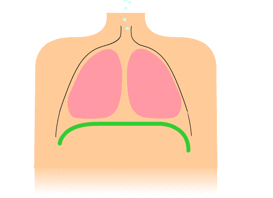

# 第五篇　动力：呼吸与支撑

## 本篇要点

- 唱歌对呼吸系统真正的要求，不是"气多"，而是**声门下压稳定、并且能随时精确调节**。
- 肺不能自己运动。吸气靠**膈肌**和提肋的肌肉，呼气靠肺和胸廓的**被动回弹**，以及腹肌等**呼气肌的主动用力**。**膈肌只负责吸气，不能主动把气推出去。**
- 声门下压主要决定**音量**，并且需要**随音高升高**。训练有素的歌手会逐音调节它。
- 被动回弹的力量随肺里剩余的气量而变化：刚吸满时太大，快用完时变成负值。**"支撑"就是在这种变化下保持并调节气压的能力**，意大利传统称之为 appoggio，即吸气肌和呼气肌之间的动态平衡。
- 气压**给得太猛**或**调节不好**，都可能让喉部去"代偿"，表现为挤卡。
- "收小腹"和"往外撑"这两种看似矛盾的说法，在职业歌手中都有人使用，它们是通向同一目标的不同策略。

---

## 一、呼吸系统是怎么工作的

### 1. 肺是被动的

肺本身没有肌肉，不能自己扩张或收缩。它被包在胸廓里，**胸腔的容积**一变化，肺就跟着被动地吸气或呼气。

### 2. 吸气

吸气主要靠两组肌肉：

- **膈肌**（横膈膜）：胸腔底部一块穹顶状的肌肉。收缩时穹顶变平、下降，胸腔向下扩大。下降的膈肌会把腹腔里的内脏往下、往前推，所以吸气时肚子会鼓起来。
- **肋间外肌**等：把肋骨向上、向外提起，胸腔向四周扩大。

*图 5-1　膈肌呼吸示意动画。绿色线是膈肌：它收缩下降时，胸腔向下扩大，两肺随之扩张，空气流入；它放松上升时，空气流出。*

### 3. 呼气

呼气有两种来源：

- **被动回弹**：吸气后，肺和胸廓像被拉开的弹簧，会自己往回缩，把气压出去。平静呼吸时，呼气几乎完全靠这个。
- **主动用力**：腹部肌肉（腹横肌、腹斜肌、腹直肌）收缩，把内脏往上推，从下方推动膈肌上升；肋间内肌把肋骨往下拉。

### 4. 膈肌不能主动推气

这里有一个很重要的事实：**膈肌只负责吸气，它不能主动把气推出去。** 呼气时，膈肌只能逐渐放松，或者保持一定张力来"刹车"，减慢呼气。对歌手的测量研究（Leanderson 等，1987）也发现，部分歌手在唱歌时膈肌仍有一定的活动，起的正是这种配合和刹车的作用。

所以，"用横膈膜发力把气顶上去"这个说法，从生理上看并不准确。而且膈肌几乎没有可以直接感知的本体感觉，我们感觉到的"横膈膜在用力"，实际上大多是腹壁和下部肋骨周围肌肉的感觉。这又是第一篇讲的"感觉的位置不等于动作的位置"的例子。

---

## 二、唱歌需要的是"压力"，不是"气量"

第二篇讲过，声带振动靠的是声带下方的气压，即**声门下压**。对唱歌来说，它有三个特点：

1. **它主要决定音量。** 声门下压越高，声音越响。
2. **它要随音高升高。** 音越高，声带被拉得越紧，需要更高的声门下压才能维持振动。所以唱高音时，即使音量不变，也需要更大的气压。
3. **它必须逐音调节。** 嗓音研究者测量过歌手唱连贯旋律时的气压，发现训练有素的歌手会随着每个音的音高和强弱，精确而迅速地调整声门下压。

相比之下，唱歌实际**消耗的气量并不大**。一个乐句能唱多长，主要取决于声带闭合得有多高效（第二篇），以及气压调节得有多经济，而不是吸了多少气。

---

## 三、"支撑"的生理含义

### 1. 被动回弹的力量随肺容量变化

问题在于，被动回弹的力量并不是恒定的，它取决于肺里还剩多少气：

| 肺里的气量 | 被动回弹产生的气压 | 唱歌时需要做什么 |
|---|---|---|
| 刚吸满气时 | 很大，常常**超过**唱歌所需，尤其是唱轻声的时候 | 用吸气肌"刹车"，防止气一下子冲出去 |
| 中间 | 接近零 | 根据需要少量主动用力 |
| 快用完时 | 变成**负值**，胸廓反而想往回扩张 | 腹肌等呼气肌主动用力，把气压出去 |

一个乐句从头唱到尾，被动回弹的气压从"太多"一路变成"不够"甚至"负数"，而声带需要的气压却要保持稳定，还要随音高和强弱精确变化。**能做到这一点，就是"支撑"。**

### 2. appoggio：吸气肌和呼气肌的动态平衡

美国声乐教育家 Richard Miller 对意大利传统中 **appoggio**（字面意思是"倚靠"，通常译为"支撑"）的定义正是：**吸气肌和呼气肌之间的动态平衡**。

- 在乐句开头，吸气肌保持张力，让胸廓不会马上塌下来，这就是常说的"保持吸气时的状态"。
- 随着乐句推进，呼气肌逐渐接手。

意大利传统里还有一个形象的说法叫 lotta vocale（声音的角力），指的就是吸气肌和呼气肌之间的这种对抗。

所以，"支撑"**不等于**"用更多的气"，也**不等于**"用力往外推"。它更接近"精确控制"。

---

## 四、动力层和声源层的平衡

第二篇讲过，声门下压和声带闭合需要互相平衡：气压是推力，闭合是阻力。从这个平衡关系可以推出两种常见的问题：

- **气压给得太猛**（"推气"）：声带必须加大闭合来抵抗，假声带和喉部肌肉也容易跟着收紧，结果就是挤压、喊叫。音越高，这种倾向越明显，因为高音本来就需要更大的气压。
- **呼吸系统调节不好**（气压忽大忽小，或者快用完时没有主动补上）：喉部会被迫承担"阀门"的工作，靠收紧来控制气流。这也是挤卡的一种来源。很多老师说的"气息不够，所以喉咙在挤"，在这个意义上是有道理的。

这两种情况，表面上都是"喉咙挤"，但原因一个是动力给得太多，一个是动力调节不好。

---

## 五、"收小腹"还是"往外撑"

这可能是不同老师之间最容易出现矛盾说法的地方：

- 有的老师说：唱的时候**小腹往里收**，用腹肌把气往上送。
- 有的老师说：唱的时候**腰腹往外撑**，保持吸气时的扩张状态，不要塌。

对职业古典歌手呼吸运动的研究（比如美国学者 Watson 与 Hixon 1985 年的研究，以及瑞典 Thomasson 与 Sundberg 1999 年的研究）发现：

- 很多歌手唱歌时，**肋骨保持扩张，同时腹壁略微向内收**。这样能让膈肌处在利于下一次快速吸气的位置，也让胸廓的肌肉处在比较有力的状态。
- 但歌手之间的差异很大，有人更强调腹部向外的扩张感。而同一位歌手的呼吸方式通常相当稳定。

这两种说法其实都在描述"吸气肌和呼气肌的平衡"，只是强调的部位和感觉不同："往外撑"强调吸气肌的刹车作用，以及肋骨保持扩张；"往里收"强调腹肌的主动参与。它们更像是通向同一个目标的不同策略，而不是一对一错。

---

## 六、常见说法的对照

| 说法 | 可能对应的机制 |
|---|---|
| 丹田、气沉丹田 | 丹田是传统武术和中医的概念，位置在脐下。在唱歌语境里，大多对应下腹部腹壁肌肉的参与感，以及吸气时让腹部自然放松、膈肌充分下降，而不是耸肩、提胸 |
| 横膈膜发力 | 膈肌只能吸气，不能主动推气。实际感觉到的多是腹壁和下部肋骨周围肌肉的活动 |
| 腹式呼吸 | 吸气时允许腹部向外移动，让膈肌充分下降。它和胸廓扩张并不冲突，好的吸气通常两者都有。真正要避免的是耸肩、锁骨上提的"肩式呼吸" |
| 腰部、后背撑开 | 下部肋骨向侧面和后面扩张，以及吸气肌在乐句中保持一定张力，也就是 appoggio 里的"刹车" |
| 吸着唱 | 两种含义：呼吸层面，指保持吸气时的胸廓状态，不让它马上塌下来；共鸣层面，指软腭上抬、咽腔打开（第四篇） |
| 气息往上顶、送气 | 主动的呼气用力。适度时是必要的，过度就会变成"推气"，导致挤压 |
| 吸满气再唱 | 唱歌通常比说话吸得深，但并非越满越好。吸得过满时被动回弹的气压太大，反而需要更多力气去"刹车"，还容易让身体整体紧张起来 |
| 气息支撑、气息压缩 | 维持并调节声门下压的能力（第二篇中"压缩"的第二种含义） |

---

## 小结

1. 肺是被动的。吸气靠膈肌和提肋的肌肉，呼气靠被动回弹和呼气肌。**膈肌不能主动推气。**
2. 唱歌需要的是**稳定、可精确调节的声门下压**，而不是大量的气。声门下压决定音量，并且要随音高升高。
3. 被动回弹的力量随肺容量从"太多"变到"负值"。**支撑**就是在这种变化下维持并调节气压的能力，即吸气肌和呼气肌的动态平衡（appoggio）。
4. 气压给得太猛，或者调节不好，都会让喉部代偿，表现为挤卡。
5. "收小腹"和"往外撑"都有职业歌手在用，是不同的策略，不是对错之分。

---

## 案例分析

> 以下是对学习者本人情况的分析，和正文理论分开。

你在讨论中表示，呼吸这部分的概念比较清楚，没有特别的困惑。所以这里只补充一个和你的高音问题相关的推测。

你唱高音时主要的问题是挤卡。从动力层的角度看，可能还有一个因素：高音本来就需要更大的声门下压，如果你在高音处习惯性地**加大推气**，同时又带着厚重的 M1（第三篇），声带和喉部就必须用更大的力去抵抗。这会进一步把身体推向第二篇讲的"用力模式"，也就是假声带合拢、喉头上提、舌根后缩这一整套反应。

这只是根据理论做的推测，需要老师现场观察确认。如果属实，它和前几篇的分析是一致的：问题不在某一个层面，而在于声源层的负担、阀门层的代偿和动力层的推力互相叠加。第六篇会把这几层放在一起讨论。

---

## 参考资料

- Miller, R. (1986). *The Structure of Singing: System and Art in Vocal Technique*. Schirmer Books. 关于 appoggio 的定义。
- Sundberg, J. (1987). *The Science of the Singing Voice*. Northern Illinois University Press. 呼吸与声门下压的关系。
- Hixon, T. J. (2006). *Respiratory Function in Singing: A Primer for Singers and Singing Teachers*. Redington Brown.
- Watson, P. J., & Hixon, T. J. (1985). Respiratory kinematics in classical (opera) singers. *Journal of Speech and Hearing Research*, 28(1), 104–122.
- Thomasson, M., & Sundberg, J. (1999). Consistency of phonatory breathing patterns in professional operatic singers. *Journal of Voice*, 13(4), 529–541.
- Leanderson, R., Sundberg, J., & von Euler, C. (1987). Role of diaphragmatic activity during singing: A study of transdiaphragmatic pressures. *Journal of Applied Physiology*, 62(1), 259–270.

## 图片来源

- 图 5-1：[Diaphragmatic breathing.gif](https://commons.wikimedia.org/wiki/File:Diaphragmatic_breathing.gif)，作者 John Pierce，CC0。
